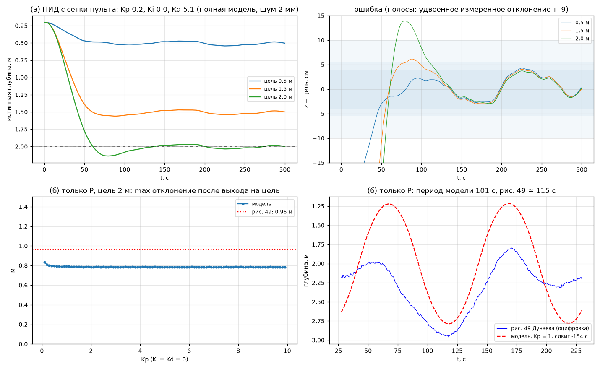
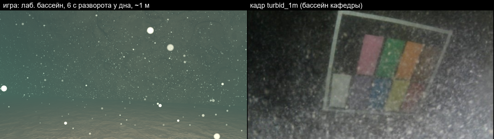
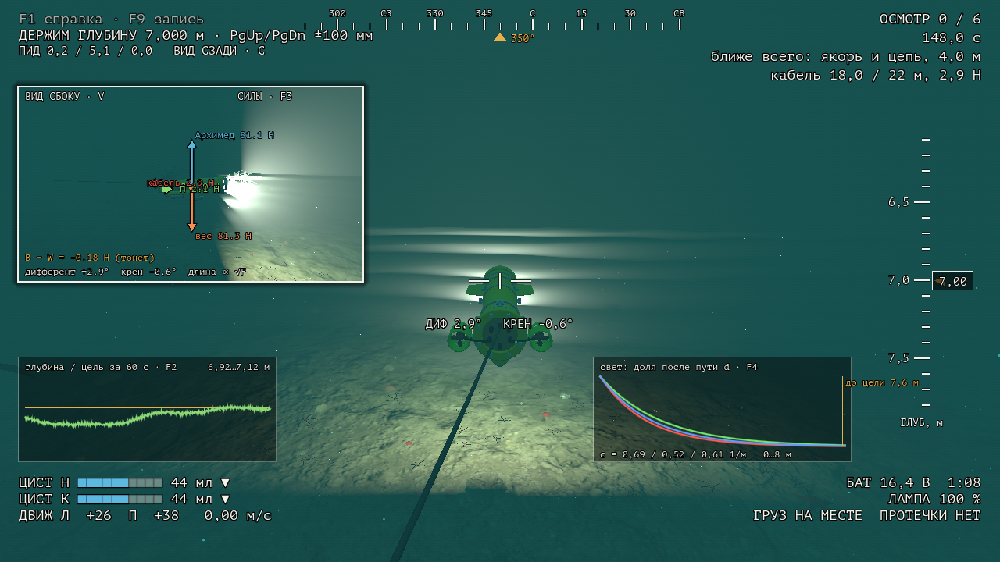
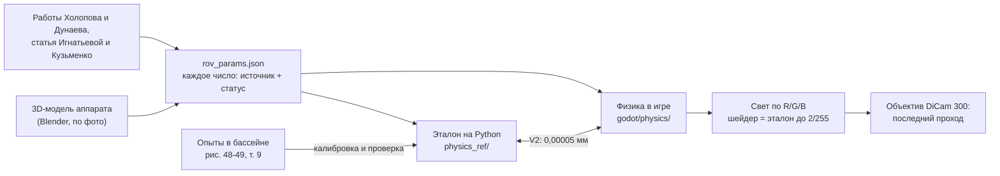

# ROV-Sim

Версия 1.4.1 · [что нового](CHANGELOG.md)

**Симулятор настоящего подводного аппарата, где у каждого числа есть источник и проверка.**

Аппарат — телеуправляемый подводный робот (ТНПА) **«Петрович»**: макет для отработки инженерных решений, который собрал и разработал коллектив кафедры морских информационных систем и технологий (МИСиТ, 2350) СПбГМТУ в рамках трёх магистерских работ. Труба Ø140 × 650 мм, два маршевых движителя, две поршневые цистерны по 70 мл для глубины и дифферента. В игре он управляется теми же командами, что с настоящего пульта (работа Павлова), движется по модели и откалиброван по опытам в бассейне кафедры (работа Дунаева), а свет в воде считается по физике и сверен с кадрами мишени (работа Холопова).


**Скачать для Windows:** [Releases](https://github.com/kholye/ROV-Sim/releases) → `ROV-Sim-1.4.1-windows-x64.zip` (≈126 МБ), распаковать, запустить `ROV-Sim.exe`. Установка не нужна, игра портативная: всё, что она сохраняет, лежит в папке `userdata` рядом с ней. Хватает встроенной видеокарты (60 кадров/с при 1280 × 720 на Ryzen 5 5500U).

**Новое в 1.4.1:** у затонувшего судна на ленте курса — метка ближайшей точки осмотра: ▲ выше аппарата, ▼ ниже, ◆ на той же глубине.

**Новое в 1.4:** аппарат ложится на дно и не проходит сквозь стены (касание — силами в уравнениях движения); наклон камеры вниз 0-30° (I / K); камера по руководству DiCam 300 — 140° по диагонали, автоэкспозиция; лабораторный бассейн по фото — гладкий бетон, иллюминатор, крышка из 6 секций (открыта одна), кабель; пауза останавливает всё; выбор сцены и «Начать», экран загрузки; настройки короче; стильный вид и гул у судна убраны. Подробно — [CHANGELOG](CHANGELOG.md).

**В 1.3:** главное меню в виде гидролокатора бокового обзора над местом крушения и экран погружения с выбором аппарата и сцены; авторы аппарата «Петрович» и симулятора — на заставке, в «Авторах», в свойствах .exe и моделях; звук (интерфейс, музыка меню, гул насосов и судна обеспечения, шорох кабеля, запись гидрофона NOAA); фото-режим F12; игра портативная. Подробно — [CHANGELOG](CHANGELOG.md).

**В 1.2:** движители у дна поднимают ил — хлопья и бурая муть, которые сносит течение; кабель-трос стал физическим: тонет, сносится течением, цепляется за судно и держит аппарат; течение у судна; камера аппарата по паспорту DiCam 300 (140°). Подробно — [CHANGELOG](CHANGELOG.md).

## За две минуты

1. **Что делаешь.** Ведёшь аппарат через 6 колец в бассейне 12 × 25 × 5 м на время или осматриваешь затонувшее судно — обросший риф в мутной северной воде — и снимаешь 6 точек вблизи, при свете лампы. Аппарат на кабеле: он ложится на дно и обломки и может зацепиться — тогда аппарат не пускает дальше, надо вернуться по своему следу. Результаты — в таблицу и CSV.
2. **Почему это трудно.** Вертикальных движителей нет: глубину меняют цистерны, медленно (1,5 мл/с), поэтому погружение надо начинать заранее. У дна струи движителей поднимают ил: полный ход над илом — и через несколько секунд перед камерой муть. Крен и боковой ход не управляются. По расчёту модели корпус без вертикальных стабилизаторов неустойчив по курсу: на ходу нос уводит, приходится подруливать.
3. **Чем отличается от игры.** Физика — уравнения Fossen (6 степеней свободы) с массой, центрами и сопротивлением, посчитанными по 3D-модели аппарата. Её же независимо считает программа на Python; расхождение с игрой 0,00005 мм глубины за минуту. Свет считается по каналам R, G, B с поглощением и обратным рассеянием, а «хоррор-стиль» (низкое разрешение, дизеринг, зерно) — только последний проход, по умолчанию выключен (настройки или Tab). Для тех, кому пульт настоящего аппарата слишком труден, есть режим «автопилот»: физика та же, пульт помогает держать курс и глубину.
4. **Чему можно верить.** Каждое число помечено: *проверено*, *подогнано* по опыту (тогда совпадение с этим опытом проверкой не считается), *оценка*. Неудачи записаны так же подробно, как успехи.

## Снимки

| | |
|---|---|
|  **Камера аппарата**: график глубины (F2), ослабление света по R/G/B (F4) |  **Бассейн** 12 × 25 × 5 м: раскладка колец из первой версии симулятора |
|  **Судно, камера аппарата**: стая тресочки у корпуса; лампа в 10 см от объектива даёт серую пелену в мутной воде — это физика, а не ошибка |  **Судно, вид сзади**: скан настоящего судна в обрастании (актинии, ламинария), гравий у борта, треска |
|  **Лабораторный бассейн 3 × 3 × 3 м**: мишень Холопова для проверки света |  **Меню**: снимок бокового обзора над местом судна, рамки целей вспыхивают по ходу линии обзора; «Погружение» — выбор аппарата и сцены |
|  **Модель аппарата** (Blender, по фото): из неё считаются объём, центры масс и плавучести, сопротивление |  **Проверка V3**: удержание глубины в модели против опытов Дунаева |
|  **Ил (1.2)**: хлопья после разворота у дна в игре (слева) и кадр мутной воды бассейна кафедры (справа) — число частиц сверено |  **Кабель (1.2)**: кабель лёг по дну и зацепился у якоря — движители работают, скорость 0, сила кабеля в окошке |

## Как это работает



- **Физика** (`godot/physics/*.gd`, без узлов движка): 6 степеней свободы по Fossen, плавучесть и цистерны, присоединённые массы и поперечное обтекание по деталям модели, два движителя, течение, датчики с шумом по Аллану, батарея, ПИД глубины как в пульте. Все числа в одном файле `godot/physics/rov_params.json`. Перевод осей физики (NED) в оси Godot — в одном модуле `ned_godot.gd`.
- **Свет** (`godot/shaders/underwater.gdshaderinc`): поглощение чистой воды по Pope & Fry, рассеяние взвесью, обратное рассеяние вдоль луча от лампы (фазовая функция Фурнье-Форанд), свет сверху. Стандартное освещение Godot не используется.
- **Ил** (`godot/physics/silt_plume.gd`, частицы `shaders/silt_flocs.gdshader`): струя движителя по Albertson → напряжение на дне → размыв по Партениадесу → облако клубов (несёт течение и струи, растёт турбулентностью, оседает) и хлопья-частицы той же массы; свет в облаке — тем же расчётом, что вода.
- **Кабель-трос** (`godot/physics/tether_cable.gd`): цепочка масс по Морисону (вес, сопротивление поперёк и вдоль, течение), нерастяжимые звенья через XPBD с точным решением цепочки, касания с дном и судном с трением, подача с судна; сила кабеля входит в уравнения аппарата.
- **Камера аппарата** (`godot/render/dicam_lens.gd`): DiCam 300 — 140° по диагонали (руководство пользователя; 122° по горизонтали на воздухе), плоское окно бокса по закону Снелла — 82° в воде; наклон вниз 0-30°; автоэкспозиция.
- **Управление** повторяет пульт на MATLAB: правый стик — два движителя со смешением «ход ± поворот», цистерны по отдельности, удержание глубины с целью в миллиметрах, ПИД со шкалой 0,0-9,9.

Подробнее: [`docs/physics-sources.md`](docs/physics-sources.md) (источник, формула, проверка и статус каждой модели), [`docs/model.md`](docs/model.md), [`docs/levels.md`](docs/levels.md), [`docs/ui.md`](docs/ui.md).

## Что проверено

Полный отчёт с графиками: [`docs/verification-report.md`](docs/verification-report.md).

| Проверка | Итог |
|---|---|
| V1 физика против формул (падение, всплытие, разворот, дифферент, равновесие) | пройдено, 8 из 8, ошибка ≤ 0,3 % |
| V2 игра против независимого расчёта на Python (60 с) | пройдено: глубина 5·10⁻⁵ мм, углы 6·10⁻⁵° |
| V3 удержание глубины против опытов в бассейне | **согласуется** на 0,5 и 2,0 м; на 1,5 м **на границе** допуска (4,1 см при 4,0); это проверка согласованности: ПИД прошивки не известен и настроен в симуляторе |
| V4 шум датчиков против т. 5 Дунаева | уход курса 2,41° против 2,85° у Дунаева (предсказание) |
| V5 свет против кадров мишени и статьи 2024 | форма кривых по базе «лампа-камера» предсказана; вода бассейна **подогнана**; спад контраста с дальностью **не пройден** (модель растёт до 1,1-1,4 м) |
| V6 энергия и покой | пройдено |
| V7 ил: скорость струи у дна против формулы Blaauw, van de Kaa; баланс масс; игра = Python | пройдено: 1,5 %; 4·10⁻¹⁵; 10⁻⁸. Хлопья против кадра мутной воды: ≈ 770 против 830 пятен на 1/м мутности; размыв **подогнан** по данным автора о почти нулевой видимости в бассейне |
| V8 кабель: цепная линия, уравнения нити в потоке, игра = Python | пройдено: натяжение 0,02 %, форма 4 мм; трение по формуле Эйлера **слабее** Кулона (μ 0,32 при 0,4) — записано |
| Кольца автопилотом на физике аппарата | 6 из 6 за 286,8 с, штраф 0 (и в сборке .exe на чистом профиле) |

**Подогнано** (совпадение с этими опытами не доказательство): расход поршня и затухание по вертикали (рис. 48), шум датчика глубины, постоянная фильтра курса, мутность воды бассейна кафедры.
**Не известно** и помечено «оценка»: настоящая масса (модель даёт 8,2 кг вместо «около 10»), тяга движителей, размеры плоскостей, паспорт датчика давления.

## Управление

| Клавиатура | Геймпад | Действие |
|---|---|---|
| W S A D, ↑ ↓ ← → | правый стик | ход и поворот |
| E / Q | крестовина + LT и RT | обе цистерны: набрать / вытеснить |
| R / F, T / G | крестовина + LT / RT | носовая / кормовая цистерна |
| H, PgUp / PgDn | B, Y / A | удержание глубины, цель на шаг мельче / глубже |
| L | LB | лампа 0 / 50 / 100 % |
| I / K | R3 | наклон камеры вверх / вниз |
| V, F2, F3, F4 | Back | окошко «со стороны», график, силы, ослабление света |
| Esc | Start | пауза: ПИД, настройки |

В настройках три режима управления: научный (как настоящий пульт), автопилот (та же физика, пульт держит курс, дифферент и глубину, E / Q — глубже / мельче) и автопилот + ускорение. Всё управление — F1 в игре и [`docs/ui.md`](docs/ui.md).

## Собрать и проверить самому

Нужны Godot 4.7.2 (без .NET; для сборки .exe — его шаблоны экспорта), Python 3.12 с пакетами из `physics_ref/requirements.txt` (окружение `physics_ref/.venv`), для сцен — Blender 4.5 LTS.

```bash
cd physics_ref
.venv/Scripts/python -m unittest discover -s tests -t .
.venv/Scripts/python verify/v1_analytic.py
```
```bash
Godot_v4.7.2-stable_win64_console.exe --headless --path godot --script res://tests/game_tests.gd
```
```bash
Godot_v4.7.2-stable_win64_console.exe --headless --path godot --export-release "Windows Desktop" ../build/ROV-Sim/ROV-Sim.exe
```

Все команды проверок — раздел «Как повторить» в отчёте. Данные авторов работ (`data/`) в репозиторий не входят.

## Авторство

**ROV-Sim** — Холопов Егор Геннадьевич, 2026.

**Аппарат «Петрович»** собран и разработан коллективом кафедры МИСиТ (2350) СПбГМТУ:
- Коротицкий Евгений Викторович, к. т. н., доцент;
- Кузьменко Александр Владимирович, старший преподаватель;
- Холопов Егор Геннадьевич, магистр: система технического зрения, кадры мишени для проверки света;
- Дунаев Артем Михайлович, магистр: математическая модель, опыты в бассейне;
- Павлов Даниил Александрович, магистр: информационно-управляющая система и пульт управления («Исследование информационно-управляющей системы МПР»).

**Первая версия симулятора**, на которой основан ROV-Sim (правила колец и осмотра судна, раскладка бассейна), — Семенов Николай Николаевич, заведующий кафедрой.

Проверка света — статья Игнатьевой Н. В. и Кузьменко А. В. (2024). Судно — скан «Malpas Metal Boat Wreck», artfletch, CC BY 4.0. Все источники и лицензии: [`docs/CREDITS.md`](docs/CREDITS.md).

Код — [MIT](LICENSE), документы, графики и модели — [CC BY 4.0](LICENSE-docs.md).

---

**In English.** ROV-Sim (by Egor Kholopov) simulates «Petrovich», a real small ROV test bed built by the Department of Marine Information Systems and Technologies (2350), SMTU, Saint Petersburg, within three master's theses (Kholopov, Dunaev, Pavlov), together with E. V. Korotitsky and A. V. Kuzmenko; the first simulator version was made by N. N. Semenov, head of the department. The vehicle: one hull, two thrusters, two 70 ml piston ballast tanks, no vertical thrusters. 6-DOF Fossen dynamics with mass properties computed from the 3D model, verified against an independent Python reference (5·10⁻⁵ mm depth error over 60 s) and calibrated/validated against pool experiments; physically based underwater light per RGB channel with backscatter, checked against target images and a 2024 paper. Since 1.4: contact forces with the bed and walls (the vehicle rests on the bottom), camera tilt, the camera lens and auto-exposure from the DiCam 300 manual, the lab pool rebuilt from a photo (lid, porthole, tether), a loading screen; the stylized view was removed. Since 1.3: a side-scan-sonar main menu, vehicle and scene selection, sound, a photo mode, and a portable build (all data next to the .exe). Since 1.2: thruster-induced sediment plumes (jet → bed shear → erosion → drifting, settling cloud with visible flocs matched to a real turbid frame), a lumped-mass tether with drag, friction and snagging that pulls on the vehicle, a seabed current, and the vehicle camera modelled from its datasheet (140° lens behind a flat port). Every parameter is tagged *verified*, *fitted* or *estimate*, and failed checks are reported. Windows build: see Releases. Interface is in Russian.
