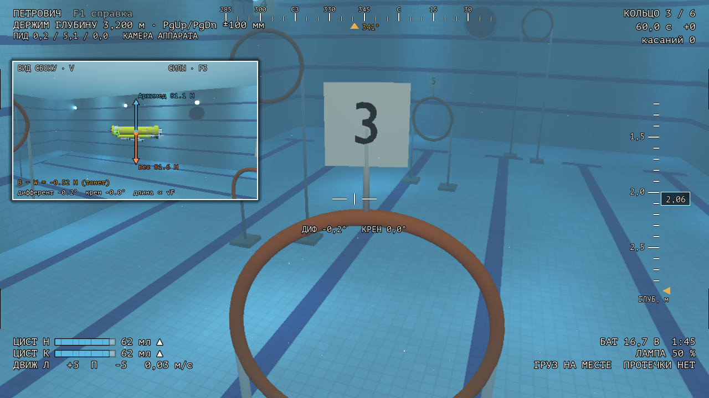
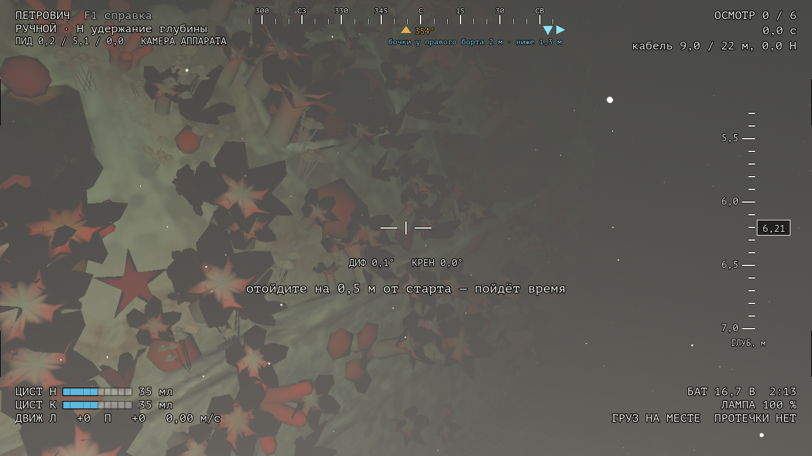
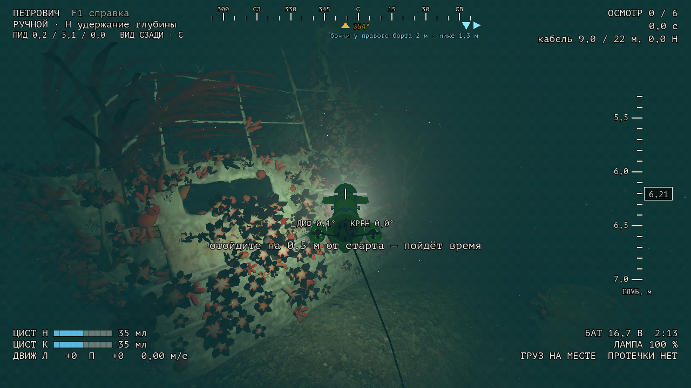
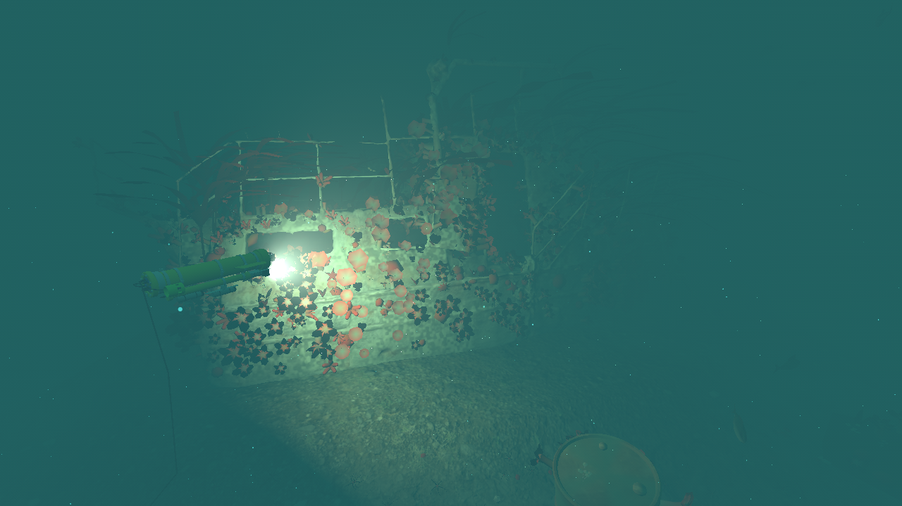
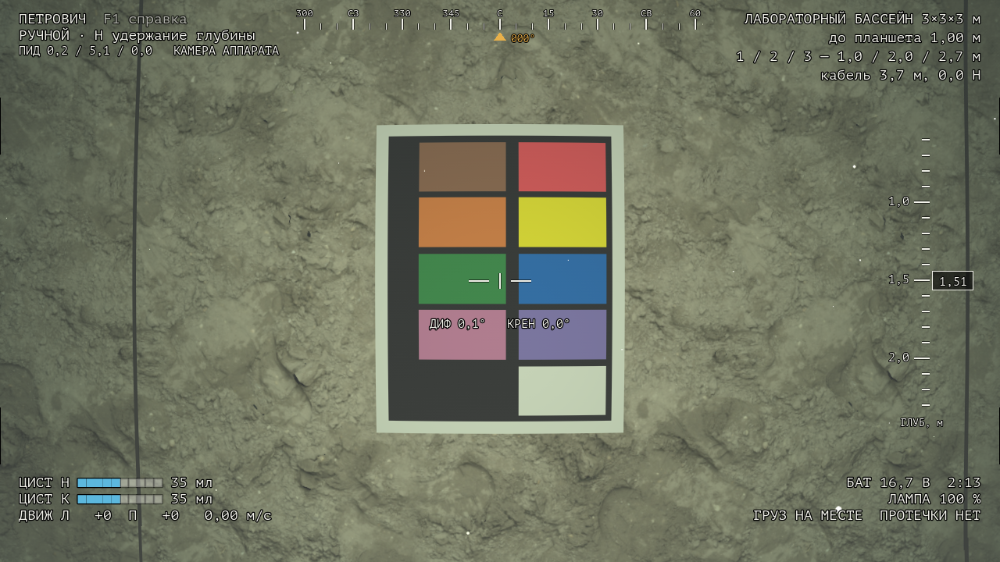
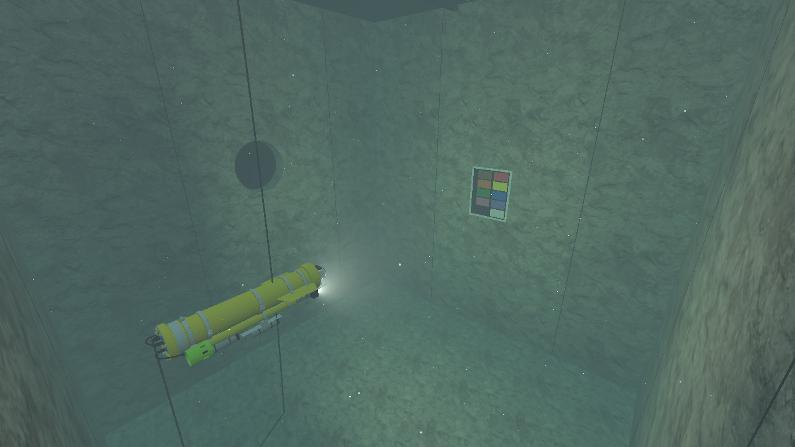
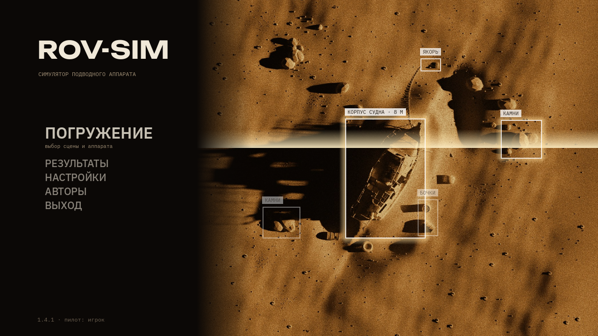
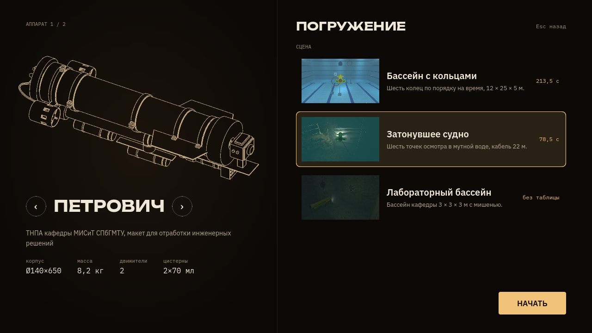

# ROV-Sim

Симулятор небольшого телеуправляемого подводного аппарата (ТНПА) «Петрович» — макета кафедры морских информационных систем и технологий СПбГМТУ. Версия 1.4.2, [изменения](CHANGELOG.md).



**Скачать:** [Releases](https://github.com/kholye/ROV-Sim/releases) → `ROV-Sim-1.4.2-windows-x64.zip` (≈126 МБ). Распаковать и запустить `ROV-Sim.exe`, установка не нужна; всё, что игра сохраняет, лежит в папке `userdata` рядом с ней. Достаточно встроенной видеокарты (60 кадров/с при 1280 × 720 на Ryzen 5 5500U). Интерфейс на русском.

## Что это

У аппарата труба Ø140 × 650 мм, два маршевых движителя и две поршневые цистерны по 70 мл. Вертикальных движителей нет: глубину меняют цистерны, медленно, поэтому погружаться приходится заранее. Крен и боковой ход не управляются. Управление — как с настоящего пульта: два движителя от одного стика, цистерны по отдельности, удержание глубины по ПИД.

Движение считается по уравнениям Fossen (6 степеней свободы). Масса, центры и сопротивление взяты из 3D-модели аппарата, часть чисел подогнана по опытам в бассейне кафедры. Свет в воде считается по каналам R, G, B: поглощение, рассеяние, пелена от лампы. Стандартное освещение движка не используется. У каждого числа в `godot/physics/rov_params.json` указаны источник и статус: *проверено*, *подогнано* или *оценка*.

## Сцены

- **Бассейн с кольцами**, 12 × 25 × 5 м: шесть колец по порядку на время. Раскладка — из первой версии симулятора.
- **Затонувшее судно** в мутной воде (видимость около 7 м): осмотреть шесть точек на корпусе вблизи, при свете лампы. Аппарат идёт на кабеле, который тонет, сносится течением и может зацепиться за обломки. Движители у дна поднимают ил. Направление на ближайшую точку показывает метка на ленте курса.
- **Лабораторный бассейн** кафедры, 3,5 × 3,5 × 3 м: мишень для проверки света. Сверху пол лаборатории из щитов, открыт один, поэтому внутри темно; зал над бассейном построен по скану LIDAR помещения и из-под воды виден через окно Снелла.

| | |
|---|---|
|  Камера аппарата у обросшего борта |  Тот же борт, вид сзади: кабель и пятно лампы |
|  Судно со стороны: дальше нескольких метров всё скрывает вода |  Мишень в лабораторном бассейне, 1 м |
|  Лабораторный бассейн: иллюминатор, мишень, кабель |  Главное меню |
|  Выбор аппарата и сцены | |

## Управление

| Клавиатура | Геймпад | Действие |
|---|---|---|
| W S A D, стрелки | правый стик | ход и поворот |
| E / Q | крестовина + LT и RT | обе цистерны: набрать / вытеснить |
| R / F, T / G | крестовина + LT / RT | носовая / кормовая цистерна |
| H, PgUp / PgDn | B, Y / A | удержание глубины, цель мельче / глубже |
| L | LB | лампа 0 / 50 / 100 % |
| I / K | R3 | наклон камеры |
| V, F2, F3, F4 | Back | окошко «со стороны», график глубины, силы, ослабление света |
| C | — | камера аппарата / вид сзади |
| Esc | Start | пауза |

Полный список — F1 в игре. В настройках есть режим «автопилот»: физика та же, но пульт сам держит курс и глубину.

## Проверки

Подробности и графики: [`docs/verification-report.md`](docs/verification-report.md), источники и формулы: [`docs/physics-sources.md`](docs/physics-sources.md).

| Проверка | Результат |
|---|---|
| V1. Движение против аналитических формул | 8 из 8, расхождение ≤ 0,3 % |
| V2. Игра против независимого расчёта на Python, 60 с | глубина 5·10⁻⁵ мм |
| V3. Удержание глубины против опытов в бассейне | на 0,5 и 2,0 м согласуется; на 1,5 м на границе допуска. ПИД прошивки не известен, поэтому это проверка согласованности, а не подтверждение |
| V4. Шум датчиков | уход курса 2,41° против 2,85° в опытах |
| V5. Свет против кадров мишени и статьи 2024 г. | форма кривых по базе «лампа — камера» совпала; спад контраста с расстоянием **не совпал**; мутность воды подогнана |
| V6. Энергия и покой | пройдено |
| V7. Ил от движителей | скорость струи у дна против формулы — 1,5 %; число хлопьев против кадра мутной воды — 770 против 830 |
| V8. Кабель | против цепной линии и уравнений нити в потоке — 4 мм по форме; трение слабее заданного (0,32 при 0,4) |
| Кольца автопилотом | 6 из 6 за 284,7 с, без штрафа |

Не известны и помечены «оценка»: настоящая масса аппарата (модель даёт 8,2 кг), тяга движителей, размеры плоскостей, вода у судна.

## Как устроено

- `godot/physics/` — физика без привязки к движку: движение, цистерны, течение, датчики, батарея, ил, кабель, касание дна и стен. Перевод осей физики в оси Godot — только в `ned_godot.gd`.
- `physics_ref/` — тот же расчёт на Python и проверки V1–V8.
- `godot/shaders/underwater.gdshaderinc` — свет в воде; совпадает с расчётом на Python до 2/255.
- `godot/render/dicam_lens.gd` — объектив камеры DiCam 300: 140° по диагонали, плоское окно бокса.
- `blender/` — скрипты, из которых собираются модель аппарата и сцены.

Сборка и проверки (нужны Godot 4.7.2, Python 3.12 с `physics_ref/requirements.txt`, для сцен — Blender 4.5 LTS):

```bash
Godot_v4.7.2-stable_win64_console.exe --headless --path godot --script res://tests/game_tests.gd
```
```bash
cd physics_ref && .venv/Scripts/python verify/v1_analytic.py
```
```bash
Godot_v4.7.2-stable_win64_console.exe --headless --path godot --export-release "Windows Desktop" ../build/ROV-Sim/ROV-Sim.exe
```

Остальные команды — в разделе «Как повторить» отчёта. Исходные данные авторов работ (`data/`) в репозиторий не входят.

## Авторство

**ROV-Sim** — Холопов Егор Геннадьевич, 2026.

**Аппарат «Петрович»** — коллектив кафедры МИСиТ (2350) СПбГМТУ:
- Коротицкий Евгений Викторович, к. т. н., доцент;
- Кузьменко Александр Владимирович, старший преподаватель;
- Холопов Егор Геннадьевич, магистр: система технического зрения, кадры мишени;
- Дунаев Артем Михайлович, магистр: математическая модель, опыты в бассейне;
- Павлов Даниил Александрович, магистр: информационно-управляющая система и пульт.

**Первая версия симулятора** (правила колец и осмотра судна, раскладка бассейна) — Семенов Николай Николаевич, заведующий кафедрой.

Проверка света — статья Игнатьевой Н. В. и Кузьменко А. В. (2024). Судно — скан «Malpas Metal Boat Wreck», artfletch, CC BY 4.0. Остальные источники и лицензии — [`docs/CREDITS.md`](docs/CREDITS.md).

Код — [MIT](LICENSE), документы, графики и модели — [CC BY 4.0](LICENSE-docs.md).

---

**In English.** ROV-Sim simulates «Petrovich», a small ROV test bed of the Department of Marine Information Systems and Technologies, SMTU (Saint Petersburg). The vehicle has two thrusters and two 70 ml piston ballast tanks and no vertical thrusters. Motion follows Fossen's 6-DOF equations with mass properties from the 3D model; underwater light is computed per RGB channel with absorption and backscatter. A Python reference reproduces the physics, and the results of the checks, including the failed ones, are listed above. Three scenes: a ring course in a pool, a wreck survey in turbid water on a tether, and the department's 3.5 × 3.5 × 3 m test tank under the lab floor (the lab is modelled from a LIDAR scan and seen through Snell's window). Windows build: see Releases. The interface is in Russian.
