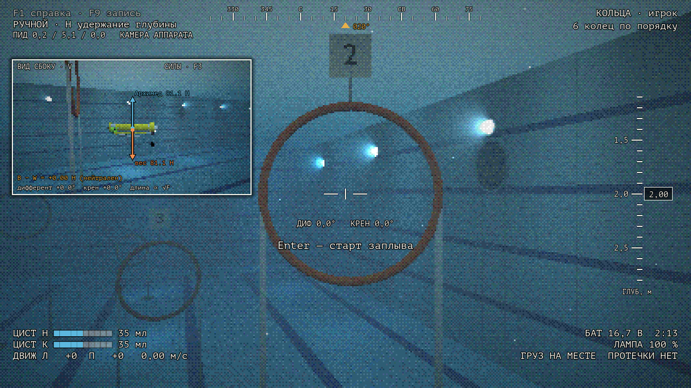
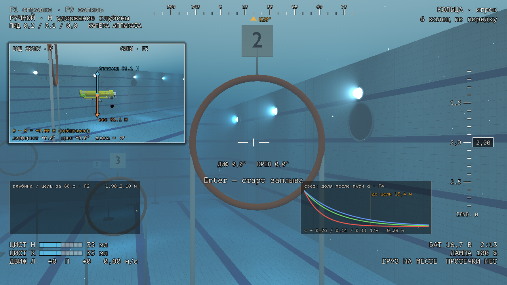
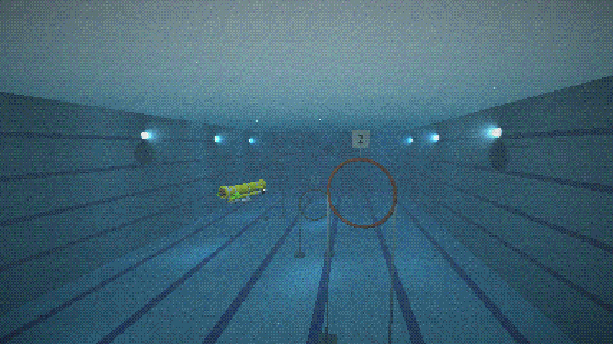
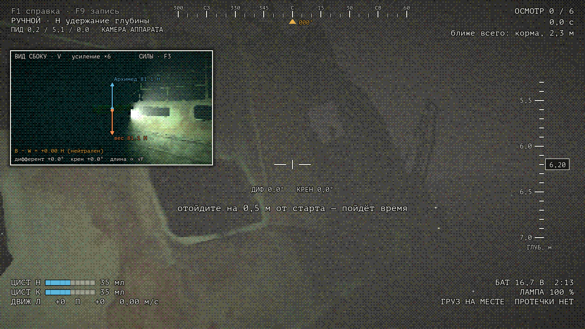
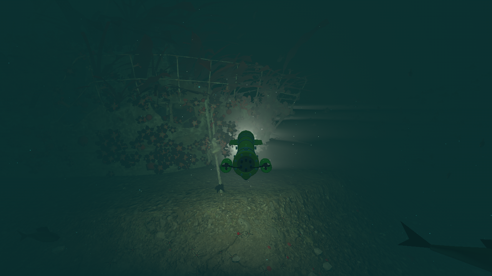
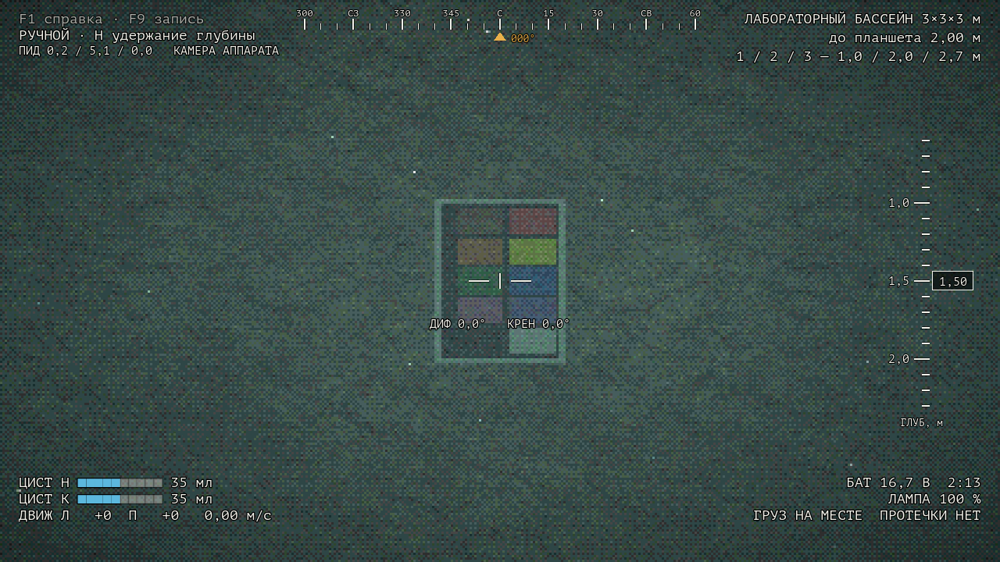
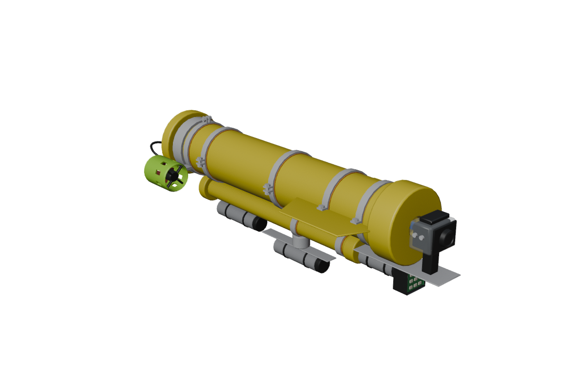
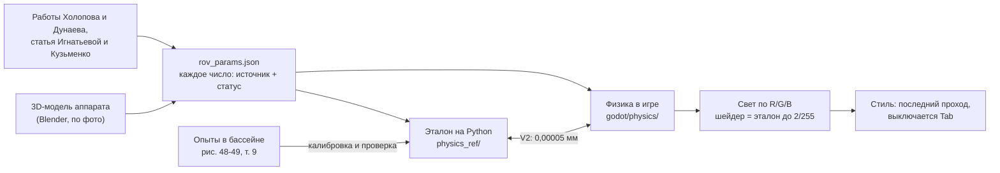

# ROV-Sim

Версия 1.0.0 · [что нового](CHANGELOG.md)

**Симулятор настоящего подводного аппарата, где у каждого числа есть источник и проверка.**

Аппарат — телеуправляемый подводный робот (ТНПА), построенный в СПбГМТУ: труба Ø140 × 650 мм, два маршевых движителя, две поршневые цистерны по 70 мл для глубины и дифферента. В игре он ведёт себя как в работах Холопова и Дунаева (2026): управляется теми же командами, что с настоящего пульта, откалиброван по опытам в бассейне кафедры, а свет в воде считается по физике и сверен с кадрами мишени.



**Скачать для Windows:** [Releases](https://github.com/kholye/ROV-Sim/releases) → `ROV-Sim-1.0.0-windows-x64.zip` (≈100 МБ), распаковать, запустить `ROV-Sim.exe`. Установка не нужна; хватает встроенной видеокарты (60 кадров/с при 1280 × 720 на Ryzen 5 5500U).

## За две минуты

1. **Что делаешь.** Ведёшь аппарат через 6 колец в бассейне 12 × 25 × 5 м на время или осматриваешь затонувшее судно в мутной воде и снимаешь 6 точек. Результаты — в таблицу и CSV.
2. **Почему это трудно.** Вертикальных движителей нет: глубину меняют цистерны, медленно (1,5 мл/с), поэтому погружение надо начинать заранее. Крен и боковой ход не управляются. По расчёту модели корпус без вертикальных стабилизаторов неустойчив по курсу: на ходу нос уводит, приходится подруливать.
3. **Чем отличается от игры.** Физика — уравнения Fossen (6 степеней свободы) с массой, центрами и сопротивлением, посчитанными по 3D-модели аппарата. Её же независимо считает программа на Python; расхождение с игрой 0,00005 мм глубины за минуту. Свет считается по каналам R, G, B с поглощением и обратным рассеянием, а «хоррор-стиль» (низкое разрешение, дизеринг, зерно) — только последний проход, он выключается клавишей Tab.
4. **Чему можно верить.** Каждое число помечено: *проверено*, *подогнано* по опыту (тогда совпадение с этим опытом проверкой не считается), *оценка*. Неудачи записаны так же подробно, как успехи.

## Снимки

| | |
|---|---|
|  **Научный вид** (Tab): без фильтров, график глубины (F2), ослабление света по R/G/B (F4) |  **Бассейн** 12 × 25 × 5 м: раскладка колец из первой версии симулятора |
|  **Судно, камера аппарата**: лампа в 10 см от объектива даёт серую пелену в мутной воде — это физика, а не ошибка |  **Судно, вид сзади**: скан настоящего судна, ил, лампа аппарата 120° |
|  **Лабораторный бассейн 3 × 3 × 3 м**: мишень Холопова для проверки света |  **Меню**: три сцены, таблица результатов, настройки |
|  **Модель аппарата** (Blender, по фото): из неё считаются объём, центры масс и плавучести, сопротивление |  **Проверка V3**: удержание глубины в модели против опытов Дунаева |

## Как это работает



- **Физика** (`godot/physics/*.gd`, без узлов движка): 6 степеней свободы по Fossen, плавучесть и цистерны, присоединённые массы и поперечное обтекание по деталям модели, два движителя, течение, датчики с шумом по Аллану, батарея, ПИД глубины как в пульте. Все числа в одном файле `godot/physics/rov_params.json`. Перевод осей физики (NED) в оси Godot — в одном модуле `ned_godot.gd`.
- **Свет** (`godot/shaders/underwater.gdshaderinc`): поглощение чистой воды по Pope & Fry, рассеяние взвесью, обратное рассеяние вдоль луча от лампы (фазовая функция Фурнье-Форанд), свет сверху. Стандартное освещение Godot не используется.
- **Управление** повторяет пульт на MATLAB: правый стик — два движителя со смешением «ход ± поворот», цистерны по отдельности, удержание глубины с целью в миллиметрах, ПИД со шкалой 0,0-9,9.

Подробнее: [`docs/physics-sources.md`](docs/physics-sources.md) (источник, формула, проверка и статус каждой модели), [`docs/model.md`](docs/model.md), [`docs/levels.md`](docs/levels.md), [`docs/ui.md`](docs/ui.md).

## Что проверено

Полный отчёт с графиками: [`docs/verification-report.md`](docs/verification-report.md).

| Проверка | Итог |
|---|---|
| V1 физика против формул (падение, всплытие, разворот, дифферент, равновесие) | пройдено, 8 из 8, ошибка ≤ 0,3 % |
| V2 игра против независимого расчёта на Python (60 с) | пройдено: глубина 5·10⁻⁵ мм, углы 6·10⁻⁵° |
| V3 удержание глубины против опытов в бассейне | **согласуется** на 0,5 и 2,0 м; на 1,5 м **на границе** допуска (4,1 см при 4,0); это проверка согласованности: ПИД прошивки не известен и настроен в симуляторе |
| V4 шум датчиков против т. 5 Дунаева | уход курса 2,41° против 2,85° у Дунаева (предсказание) |
| V5 свет против кадров мишени и статьи 2024 | форма кривых по базе «лампа-камера» предсказана; вода бассейна **подогнана**; спад контраста с дальностью **не пройден** (модель растёт до 1,1-1,4 м) |
| V6 энергия и покой | пройдено |
| Кольца автопилотом на физике аппарата | 6 из 6 за 286,8 с, штраф 0 (и в сборке .exe на чистом профиле) |

**Подогнано** (совпадение с этими опытами не доказательство): расход поршня и затухание по вертикали (рис. 48), шум датчика глубины, постоянная фильтра курса, мутность воды бассейна кафедры.
**Не известно** и помечено «оценка»: настоящая масса (модель даёт 8,2 кг вместо «около 10»), тяга движителей, размеры плоскостей, паспорт датчика давления.

## Управление

| Клавиатура | Геймпад | Действие |
|---|---|---|
| W S A D, ↑ ↓ ← → | правый стик | ход и поворот |
| E / Q | крестовина + LT и RT | обе цистерны: набрать / вытеснить |
| R / F, T / G | крестовина + LT / RT | носовая / кормовая цистерна |
| H, PgUp / PgDn | B, Y / A | удержание глубины, цель на шаг мельче / глубже |
| L | LB | лампа 0 / 50 / 100 % |
| Tab | X | стильный вид (по умолчанию выключен; есть в настройках) |
| V, F2, F3, F4 | Back | окошко «со стороны», график, силы, ослабление света |
| Esc | Start | пауза: ПИД, настройки |

В настройках три режима управления: научный (как настоящий пульт), автопилот (та же физика, пульт держит курс, дифферент и глубину, E / Q — глубже / мельче) и автопилот + ускорение. Всё управление — F1 в игре и [`docs/ui.md`](docs/ui.md).

## Собрать и проверить самому

Нужны Godot 4.7.2 (без .NET; для сборки .exe — его шаблоны экспорта), Python 3.12 с пакетами из `physics_ref/requirements.txt` (окружение `physics_ref/.venv`), для сцен — Blender 4.5 LTS.

```bash
cd physics_ref
.venv/Scripts/python -m unittest discover -s tests -t .
.venv/Scripts/python verify/v1_analytic.py
```
```bash
Godot_v4.7.2-stable_win64_console.exe --headless --path godot --script res://tests/game_tests.gd
```
```bash
Godot_v4.7.2-stable_win64_console.exe --headless --path godot --export-release "Windows Desktop" ../build/ROV-Sim/ROV-Sim.exe
```

Все команды проверок — раздел «Как повторить» в отчёте. Данные авторов работ (`data/`) в репозиторий не входят.

## Авторство

Идея и аппарат — **Холопов** (СПбГМТУ, 2026). Модель и опыты в бассейне — ВКР **Дунаева** (СПбГМТУ, 2026). Проверка света — статья **Игнатьевой Н. В. и Кузьменко А. В.** (2024). Правила колец и судна — из первой версии симулятора, сделанной преподавателем. Судно — скан «Malpas Metal Boat Wreck», artfletch, CC BY 4.0. Все источники и лицензии: [`docs/CREDITS.md`](docs/CREDITS.md).

Код — [MIT](LICENSE), документы, графики и модели — [CC BY 4.0](LICENSE-docs.md).

---

**In English.** ROV-Sim simulates a real small ROV built at SMTU (Saint Petersburg, 2026): one hull, two thrusters, two 70 ml piston ballast tanks, no vertical thrusters. 6-DOF Fossen dynamics with mass properties computed from the 3D model, verified against an independent Python reference (5·10⁻⁵ mm depth error over 60 s) and calibrated/validated against pool experiments; physically based underwater light per RGB channel with backscatter, checked against target images and a 2024 paper. Every parameter is tagged *verified*, *fitted* or *estimate*, and failed checks are reported. Windows build: see Releases. Interface is in Russian.
