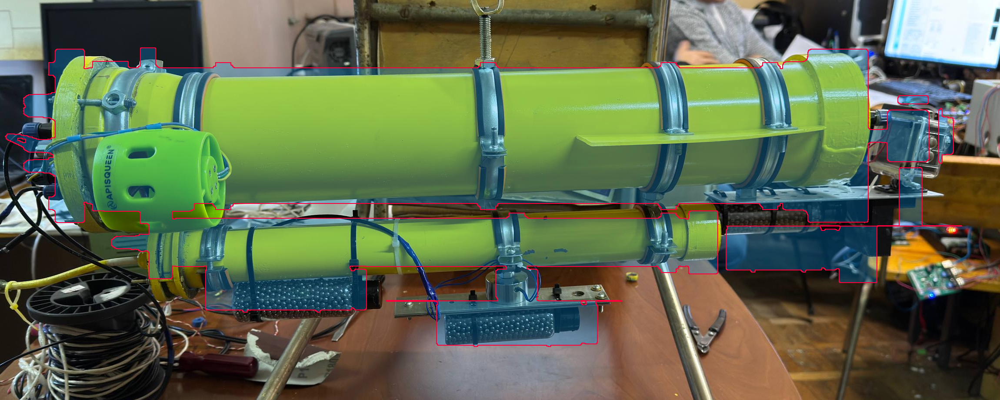

# Модель аппарата

Дата: 2026-11-02, версия 2 (доводка внешнего вида в тот же день, см. раздел «Версия 2»). CAD нет: модель построена по 5 фото `reference/`, размерам из работ Холопова и Дунаева, конфигу физики `godot/physics/rov_params.json` и данным автора.

## Файлы
| Файл | Что это |
|---|---|
| `blender/build_rov.py` | скрипт, строящий модель с нуля (Blender 4.5, bpy/bmesh). Все размеры здесь |
| `blender/render_views.py` | собирает модель без окна, рендерит виды в `docs/model/`, сохраняет `blender/rov.blend` |
| `blender/overlay_photo.py` | накладывает вид сбоку на фото `photo_2026-10-24_12-41-14.jpg` |
| `blender/rov_report.json` | отчёт сборки: треугольники, объём и замкнутость каждой детали, габариты, центр объёма |
| `godot/assets/rov/rov.glb` | экспорт glTF для Godot |
| `godot/scenes/rov_model.tscn` | сцена просмотра (модель вращается) |
| `godot/tests/model_tests.gd` | проверки модели в Godot без окна |

Пересборка (Blender не нужно открывать):
```
D:/Apps/Blender/blender.exe -b --factory-startup --python blender/render_views.py
python blender/overlay_photo.py
D:/Apps/Godot/Godot_v4.7.2-stable_win64_console.exe --headless --path godot --import
D:/Apps/Godot/Godot_v4.7.2-stable_win64_console.exe --headless --path godot --script res://tests/model_tests.gd
```

## Оси и начало координат
Размеры в скрипте заданы в системе тела Fossen (NED: x вперёд, y вправо, z вниз). Начало координат: центр габарита 650 мм на оси главной трубы, то есть то же начало, что у `rov_params.json` (`cb = 0`). В Blender: X = вправо, Y = вперёд, Z = вверх. Экспортёр glTF переводит это в Godot ровно как `NedGodot.vec()`: вперёд = −Z, вправо = +X, вверх = +Y. Поэтому модель ставится на узел аппарата без поворотов, а перевод систем по-прежнему делается только в `ned_godot.gd`.

## Размеры
Статусы как в физике: `проверено` (из работ), `конфиг` (взято из `rov_params.json`, там свой источник), `оценка` (промер по фото).

Промер по фото: снимок 12-41-14 снят почти точно сбоку. Продольный масштаб взят по габариту 650 мм (2,25 px/мм на уменьшенном снимке), поперечный по фланцу Ø140 (2,14 px/мм). Разница масштабов около 5 % это перспектива, такова и точность промеров.

| Часть | Размер, мм | Положение (NED), мм | Статус |
|---|---|---|---|
| Габарит корпуса | 650 × Ø140 (кормовой фланец − носовой колпак) | x −325…+325 | проверено (Дунаев т.1; Холопов 3.1); Ø140 — фланцы и колпак, главная труба Ø110 (по фото и данным автора) |
| Главная труба | Ø110 | x −300…+255 | оценка (отношение к фланцу 1 : 1,36 по фото; похоже на ПВХ 110) |
| Кормовой фланец | Ø140 × 25 | x −325…−300 | оценка |
| Носовой колпак | Ø120 × 20 + Ø140 × 50, гнездо разъёма Ø32 | x +255…+325 | оценка |
| Хомуты (лента, оранжевая прокладка, ушки с болтами с двух сторон) | Ø119 × 14, 5 шт. + стяжной у фланца | x −250 (движители, ушки сверху-снизу), −190, +21, +165, +246 | оценка |
| Кормовой фланец: болты и гермовводы | 8 болтов M6 на r = 58; 6 гермовводов на текстолитовой крышке Ø92 | торец x −325 | оценка |
| Нижняя труба (энергоотсек) | Ø40, фланец Ø60, заглушка Ø52; длина 455 | x −250…+205, ось z = +85 | оценка (по фото) |
| Груз неотделяемый, корма | гильза Ø35 × 130 | x −140, под нижней трубой | оценка |
| Груз сбрасываемый (`ballast_drop`) | гильза Ø35 × 130 + якорь 190 × 25 | x +44, под электромагнитом Ø35 | оценка |
| Груз неотделяемый, нос | гильза Ø35 × 90 | x +255, под пластиной | оценка |
| Носовая пластина | 190 × 60 × 2 | x +210…+400, z +71…+73 | оценка |
| Камера (прозрачный бокс, внутри корпус, рамка, объектив, защёлка, кнопки) | 45 × 65 × 50, объектив Ø32 | x +335…+393, на оси; разъём кабеля между колпаком и боксом | оценка (по наложению на фото) |
| Лампа (чёрный бокс, плата, 9 светодиодов 3 × 3) | 33 × 50 × 45 | x +300…+333, центр z = +95,5 (под пластиной, за камерой) | оценка (по наложению на фото) |
| Плоскости (пара) | трапеция: корень 200, конец 143, вылет 70 с борта трубы, толщина 3 | центр x +190, в плоскости z = 0 | конфиг (`fins[0]`) |
| Движители | насадка Ø62 × 75, ступица, 4 лопасти | x −250, y ±110, z +30 (ниже оси) | конфиг (`thruster_pos`, по фото); габарит Дунаев 1.5.1 |
| Цистерны (внутри) | Ø40 × 56 = 70 мл | x +250 / −250 на оси | конфиг (`tank_x`, `tank_capacity`); форма оценка |

Лампа стоит на 62,5 мм позади объектива и на 95,5 мм ниже его оси: это база «лампа-камера» для этапа 4 (V5).

Метки (пустые узлы): `CG` = `cg_dry`, `CB` = `cb`, `camera_eye` (для Camera3D), `lamp_emitter` (для SpotLight3D), `thruster_L/R` (точки приложения тяги; винт `*_prop` можно вращать), `ballast_drop` (отцепить узел целиком при сбросе груза). Внутренние цистерны помечены `internal = true` в extras, в игре их можно скрыть.

Уточнения против первых промеров (пересчитаны единым масштабом): нижняя труба Ø40 вместо 45, ось на 85 мм ниже вместо 90, длина 455 вместо 515; лампа на 95 мм ниже оси вместо 80: бокс висит под пластиной, а пластина проходит под носовым колпаком Ø140, выше она не помещается.

## Версия 2: доводка внешнего вида
Что изменилось против версии 1:
- фаски на кромках (модификатор Bevel по углу 30°, 1-2 сегмента, 0,6-4 мм) и взвешенные нормали (Weighted Normal): цилиндры гладкие, кромки чёткие; модификаторы живые, применяются при экспорте;
- 32 сегмента у корпуса (было 24), 24 у хомутов и насадок;
- детали: болты и текстолитовая крышка с гермовводами на кормовом фланце, хомуты с прокладками, ушками и болтами, прорези насадок (Boolean), мотор с крестовиной, винт с круткой лопастей по шагу 40 мм/об и красным обтекателем, пробки и стяжки гильз с дробью, хомуты нижней трубы, гермоввод энергоотсека, бокс камеры с корпусом внутри, лампа с платой и 9 светодиодами, кабели движителей;
- одинаковые болты и гермовводы делят один меш (в Godot это одна сетка на все копии);
- 13 материалов `MAT_*` (окрашенный ПВХ, сталь, резина, стекло бокса, светодиоды с излучением);
- камера и лампа поставлены по наложению на фото (в версии 1 камера стояла на 25 мм дальше, лампа на 50 мм).

Сборка делается в фоновом Blender (`-b`), так надёжнее.

## Проверка

| Проверка | Результат | Статус |
|---|---|---|
| Габарит корпуса 650 × 140 мм, допуск 1 мм | Blender: 650,000 × 140,000 × 140,000; Godot: 650,00 × 140,00 × 140,00 | пройдено |
| Полный габарит (с камерой, разъёмами, грузами) | 765 × 282 × 240 мм | для справки |
| Треугольников | 15 384 (цель 10-15 тыс.); 87 объектов, 13 материалов; все детали замкнуты (manifold) | пройдено (на 2,6 % выше верхней границы) |
| Части названы | движители, винты, цистерны, лампа, камера, плоскости, ЦМ, ЦВ и др.: 18 обязательных узлов найдены в Godot | пройдено |
| Положения против конфига (Godot, допуск 1 мм) | ЦМ, ЦВ, оба движителя, обе цистерны, центр и площадь плоскостей совпадают с `rov_params.json` | пройдено |
| Направление осей | нос (камера) в −Z Godot, как в `NedGodot` | пройдено |
| Наложение на фото | `docs/model/overlay_side.png`: корпус, фланцы, хомуты, нижняя труба, грузы, плоскость, камера, лампа совпадают в пределах перспективы | пройдено, кроме движителя (см. ниже) |
| Физика Godot после пересборки | `physics_tests.gd`: ни одного FAIL | пройдено |
| Объём против конфига | Godot: объём сетки 8,2855 л, физика 8,2858 л (допуск 1 %) | пройдено (после пересмотра физики, см. ниже) |



Снимки: `docs/model/three_quarter.png`, `three_quarter_stern.png`, `side_ortho_1mm.png`, `top_ortho.png`, `front_ortho.png`, `closeup_nose.png`, `closeup_thruster.png`, `godot_view.png`.

### Что физика берёт из модели (2026-11-02)
Для величин, которых нет в работах (подробная геометрия, центры, инерция), физика берёт числа **из модели** (`physics_ref/verify/model_properties.py --write`, подробно `docs/physics-sources.md`, разд. 2, 5-7, 16, и `docs/verification-report.md`, «Пересмотр по модели аппарата»):

1. **Объём и масса.** Масса = ρ·(V_модели − 70 мл) = **8,20 кг** («около 10 кг» в работах соответствует цилиндру Ø140; аппарат не взвешивался). Вытесненный объём модели 8,29 л (в версии 2 было 8,36 л: корпус камеры внутри бокса считался дважды, исправлено признаком `in_volume`). Баланс масс 27 деталей + остаток 1,69 кг даёт ЦМ и инерцию. Проверка в Godot: объём сетки = объём в физике (±1 %).
2. **Форма корпуса по деталям.** Присоединённые массы считаются полосами по каждой трубе, гильзе, насадке и плоскостям; сопротивление по силуэтам модели (сбоку 0,114 м², сверху 0,093 м², спереди 0,024 м²). Расход поршня и затухание по вертикали подогнаны по рис. 48 заново.
3. **Центр плавучести** из модели (12,5; 0; 13,5) мм; ЦМ (12,6; 0; 42,2) мм из баланса масс, x подобран для равновесия по дифференту. Метацентрическая высота 28,7 мм (было 20).
4. **Движители** опущены на 30 мм (`thruster_pos` z = 0,03), модель пересобрана по новому конфигу.

Остаётся: хорда плоскостей по фото ≈225 мм против 200 в конфиге (взято по конфигу).
