# Отчёт проверки физики (этап 2, пересмотр по модели этапа 3, свет и уровни этапа 4, интерфейс этапа 5, сборка этапа 6)

Дата: 2026-11-02 (на этапе 6 все проверки прогнаны заново, числа совпали; раздел «Этап 6»), после калибровки по данным бассейна и пересмотра по 3D-модели аппарата (раздел «Пересмотр по модели аппарата»). Модели и источники: [`physics-sources.md`](physics-sources.md). Числа: [`godot/physics/rov_params.json`](../godot/physics/rov_params.json) (у каждого числа статус: проверено / подогнано / оценка). Графики и сырые результаты (JSON): [`docs/verification/`](verification/).

Слова, которые встретятся:
- **Эталон**: независимый расчёт на Python, с которым сверяется игровая физика.
- **Калибровка (подгонка)**: неизвестное число подбирается так, чтобы модель повторила опыт. После этого совпадение с **этим** опытом уже не проверка.
- **Предсказание**: модель сравнивается с опытом, который в подгонке не участвовал. Только такое совпадение что-то доказывает.
- **Предельный цикл**: колебания, которые не затухают и не растут.
- **Момент Мунка**: момент от присоединённых масс, разворачивающий вытянутое тело поперёк потока.

## Итог

| Проверка | Что сравнивали | Результат | Вид |
|---|---|---|---|
| V1 Аналитика | 6 ст. св. против формул | **пройдено**, 8 из 8 | проверка |
| V2 Независимая реализация | Godot против SciPy, 60 с; производные в 3 состояниях (в т. ч. после сброса груза) | **пройдено**: глубина 5·10⁻⁵ мм, углы 6·10⁻⁵°, производные 2·10⁻¹⁶ | проверка |
| V3(б) Только P, рис. 49 | размах и период | **согласуется**: 0,78-0,84 м и 101 с против 0,96 м и 115 с (после пересмотра без изменений) | предсказание |
| V3(а) Настроенный ПИД, т. 9 | max отклонение в установившемся режиме | **0,5 и 2,0 м согласуются** (10 из 10 реализаций шума); **1,5 м на границе**: медиана 4,08 см при допуске 4,0 см, в допуске 4 из 10 (на физике этапа 2 было 3,94 см и 5 из 10) | предсказание (шум датчика подогнан, см. ниже) |
| V4 Датчики | уход курса за 20 мин | гироскоп без магнитометра 2,41° против 2,85° у Дунаева (**предсказание**); с магнитометром 0,15° (**подогнано**) | смешанный |
| V6 Здравый смысл | энергия, покой | **пройдено** | проверка |
| V5 Свет: порт | шейдер Godot против эталона Python, 6 конфигураций | **пройдено**: ≤ 2/255 | проверка |
| V5 Свет: кадры Холопова | V/S кадров, контраст т. 4 | вода бассейна **подогнана** по V/S кадров 2,7 м; контраст т. 4 предсказан ниже на 22-23 % (в допуске ±25 % по среднему) | смешанный |
| V5 Свет: статья | кривые рис. 10-13 | **согласуется**: спад K(2,7)/K(0,8) 0,45 против 0,45; рост по базе ×3,0 и ×1,16 против ×3,0 и ×1,09; 62-71 % значений в ±25 %; (а) монотонный спад **не пройден** (модель растёт до 1,1-1,4 м) | предсказание |
| Уровни (этап 4, после доработки) | кольца, осмотр судна, кадры/с | 6 колец автопилотом за 286,8 с, штраф 0; осмотр 6 точек с отчётом; ≥ 34 к/с при 1280 × 720 (худший кадр), в среднем 45-60 | проверка |
| Интерфейс (этап 5): S4, S5, S7 | управление = кадр пульта, кадры/с с интерфейсом, таблица результатов | **пройдено**: 16 новых проверок; 55-60 к/с в среднем с синхронизацией; кольца 286,8 с с записью в таблицу. тест на людях не проводился | проверка |
| S1 Источники (этап 6) | у каждой модели источник, формула, проверка, статус; у каждого числа источник и статус | **пройдено** после дописывания 9 разделов: 28 разделов, 89 чисел (проверено 19, подогнано 7, оценка 63) | проверка |
| Сборка .exe (этап 6) | запуск из новой папки с пустым профилем | **пройдено на ПК автора**: меню, три сцены, кольца автопилотом 286,8 с, 60 к/с; на других ПК не проверялось | проверка |

Сводка критериев успеха проекта:

| Критерий | Итог |
|---|---|
| S1 у каждой модели источник и статус | **пройдено** (`verify/s1_sources.py`) |
| S2 движок = независимый расчёт, < 1 мм за 60 с | **пройдено**: 5·10⁻⁵ мм (V2) |
| S3 удержание глубины не хуже вдвое от бассейна, без колебаний; только P — порядка метра | **частично**: 0,5 и 2,0 м в допуске, 1,5 м на границе (медиана 4,08 см при 4,0); остаётся медленный цикл ±2-3 см с периодом 107-140 с; только P — 0,8 м (рис. 49: 0,96). Проверка согласованности, не валидация |
| S4 управление как у настоящего | **пройдено** (13 проверок) |
| S5 ≥ 30 к/с при 1280 × 720 на ПК автора | **пройдено** в среднем (55-60); единичные кадры до 17-34 к/с |
| S6 новичок понимает за 2 минуты | **материалы готовы** (README, 8 снимков); видео и проверка на людях не делались |
| S7 таблица результатов и штрафы | **пройдено** |

Что подогнано (все пять чисел помечены в `rov_params.json`): расход поршня 1,485 мл/с и затухание по вертикали 9,62 Н·с/м (по рис. 48, заново после пересмотра), шум датчика глубины 2 мм (в пределах 2-7 мм, которые дают записи Дунаева), постоянная фильтра курса модуля 3 с (по 0,15°). Единицы таблицы 5 взяты в градусах по рисункам той же работы (не подгонка): подробно ниже.

Что осталось «оценкой» и не проверяется: масса, центр масс и инерция (из модели и баланса масс), присоединённые массы, сопротивление, плоскости, тяга движителей, батарея. Подробно в `physics-sources.md`.

---

## Пересмотр по модели аппарата (2026-11-02)

На этапе 2 корпус был упрощён до цилиндра Ø140 × 650 мм массой 10 кг с центром плавучести на оси: подробной геометрии в работах нет. После модели этапа 3 недостающие величины смоделированы по ней. Теперь все геометрические числа считает скрипт `physics_ref/verify/model_properties.py` по 3D-модели (объём и центр каждой детали, силуэты 1 px = 1 мм) и записывает в `rov_params.json`.

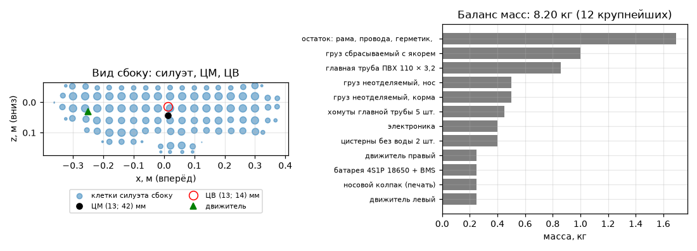

| Величина | Было (этап 2) | Стало | Почему |
|---|---|---|---|
| Масса | 10 кг («около 10», Холопов; `mass = 10`, Дунаев) | **8,20 кг** | нейтральность при 70 мл и объём модели 8,29 л (главная труба Ø110); аппарат не взвешивался |
| Центр плавучести | на оси (0; 0; 0) | (12,5; 0; 13,5) мм | центр вытесненного объёма модели: нижняя труба и грузы ниже оси |
| Центр масс | (0; 0; 20) мм, выбран | (12,6; 0; 42,2) мм | баланс масс 27 деталей + остаток 1,69 кг; x из равновесия по дифференту |
| Метацентрическая высота z_g − z_b | 20 мм | 28,7 мм | |
| Инерция Ix / Iy / Iz | 0,025 / 0,364 / 0,364 кг·м² | 0,036 / 0,292 / 0,271 | баланс масс вместо сплошного цилиндра 10 кг |
| Присоединённые массы | диагональ, один цилиндр Ø140: Y = Z = 9,99 кг, K = 0 | полная матрица по деталям: Y 8,06, Z 10,43 кг, K 0,024 кг·м², связь Z–M −0,38 | полосы по трубам, гильзам, насадкам; **плоскости +2,37 кг по вертикали** |
| Сопротивление | цилиндр: спереди 0,0154 м², поперёк 0,0916 м² для v и w | силуэты: спереди 0,0243, сбоку 0,1144, сверху 0,0932 м² по клеткам 40 мм | поперечное обтекание по каждой клетке: появились демпфирование крена и моменты от смещения силуэта вниз |
| Плоскости | одна пара на оси | левая и правая (y = ±0,088 м) | без этого плоскости не гасили крен |
| Движители | на оси корпуса | на 30 мм ниже | фото и наложение модели |
| Сброс груза | ЦМ груза в общем ЦМ, объём 127 мл (сталь) | груз в своей точке (38; 0; 149) мм, объём 131 мл по модели | после сброса ЦМ поднимается, ЦВ смещается |
| Расход поршня / затухание по вертикали | 1,49 мл/с / 9,66 Н·с/м | 1,485 мл/с / 9,62 Н·с/м | перекалибровка по рис. 48 (RMS 16 мм, как раньше) |

Что из этого следует для проверок:
- Калибровка по рис. 48 почти не сдвинулась: медленное всплытие определяют перевес и затухание, а не инерция. Значит, рис. 48 массу не проверяет; взвешивание аппарата остаётся главным открытым вопросом.
- Ошибки, найденные по пути и исправленные: формула V1(г) не учитывала смещение ЦВ (θ = −atan((x_g − x_b)/(z_g − z_b))); объём корпуса камеры внутри прозрачного бокса считался дважды (+0,08 л); координата пикселя бралась по углу, а не по центру, это сдвигало силуэт на 0,5 мм вбок и раскачивало неустойчивость по курсу.
- Неустойчивость по курсу (раздел V1) осталась, она свойство формы: вертикальных плоскостей нет. Дифферент с плоскостями теперь устойчив до 0,62 м/с (было 0,49).
- Цена в Godot: шаг RK4 0,5 мс вместо 0,4 (≈ 200 клеток силуэтов), при 200 Гц около 10 % одного ядра.

## Калибровка по опытам в бассейне

### 1. Единицы таблицы 5 Дунаева

Числа таблицы 5 взяты в градусах (°/√с, °/с), как на рисунках той же работы (рисунки извлечены из PDF, оси подписаны **«град/с»**):

| 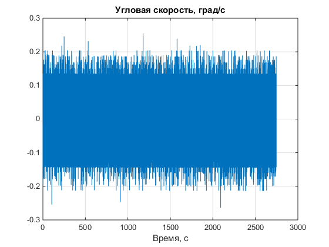 | 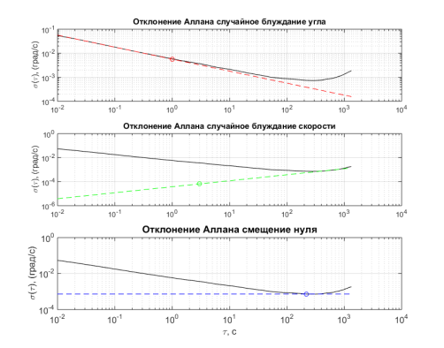 |
|---|---|
| рис. 24: сырой гироскоп, «Угловая скорость, град/с», разброс ±0,06 °/с при 100 Гц, отсюда N ≈ 0,06/√100 = 0,006 °/√с | рис. 25: кривая Аллана, ось «(град/с)», точка N при τ = 1 с ≈ 5,7·10⁻³ |

Это же подтверждают: паспорт модуля (прил. Б, т. 10) даёт 0,005 °/с/√Гц и 4 °/ч, что совпадает с числами т. 5 в градусах; моделирование самого Дунаева (т. 8) даёт 2,85° за 1200 с, а наша модель с числами в градусах 2,41° (в рад/с было бы 138°); акселерометры (рис. 31, м/с²) совпадают с т. 6 и с паспортом (60 мкg/√Гц ≈ 5,9·10⁻⁴). В `rov_params.json` числа переведены в радианы, источник записан.

На рис. 25 минимум кривой Аллана около τ ≈ 250 с; модель по N и B таблицы 5 даёт минимум при 18-25 с. Исходных записей датчика для уточнения нет, поэтому взяты числа таблицы.

### 2. Удержание глубины: аппарат калиброван по рис. 48, рис. 49 и т. 9 предсказаны

Из PDF извлечены рис. 48 и 49 (`work/tools/pdf_images.py`) и оцифрованы по пикселям (`work/tools/digitize.py`, точность ≈ 4 мм и 0,5 с): `verification/dunaev_fig48_digitized.csv`, `dunaev_fig49_digitized.csv`.

До калибровки (неизвестные расход поршня и затухание были оценками) модель отличалась от бассейна: всплытие в 2,5 раза быстрее, колебания «только P» с периодом 60 с вместо 115, а с ПИД предельный цикл ±9 см вместо 2-5 см при любых коэффициентах.

**Калибровка (`physics_ref/verify/calibrate_fig48.py`).** Рис. 48 это чистый опыт: аппарат лежит на дне, насосы вытесняют воду, аппарат всплывает. Подогнаны только два неизвестных числа: расход поршня и линейное затухание по вертикали (трос в опытах был). Нейтральность оставлена 70 мл из кода Дунаева.

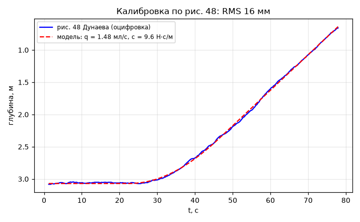

Результат: **1,49 мл/с на цистерну** (после пересмотра по модели аппарата 1,485) (в коде Дунаева 3,2; в комментарии «5 мл/с» на две, то есть 2,5) и **9,66 Н·с/м** (после пересмотра 9,62), RMS 16 мм. Скорость всплытия 0,055 м/с, как в бассейне (формула V1(ж) сходится до 0,04 %).

Прежде чем остановиться на этом, я проверил другие схемы управления поршнями: «реле» Дунаева с общей мёртвой зоной, поршень в положение, пропорциональное ошибке, скорость поршня, пропорциональная ошибке. Подгонка сразу по рис. 48 и 49 ни в одной схеме не сошлась (RMS 0,2-0,3 м). Запись рис. 49 короткая и, похоже, не чисто регуляторная. Поэтому рис. 49 используется не для подгонки, а для проверки по двум признакам: размаху и периоду.

Чем этот выбор плох: расход и затухание зависят от принятой нейтральности. При 40 мл вышло бы 0,83 мл/с и 4,3 Н·с/м, при 100 мл 2,14 мл/с и 15 Н·с/м. Как это влияет на выводы, показано в таблице чувствительности ниже.

## V1. Аналитика

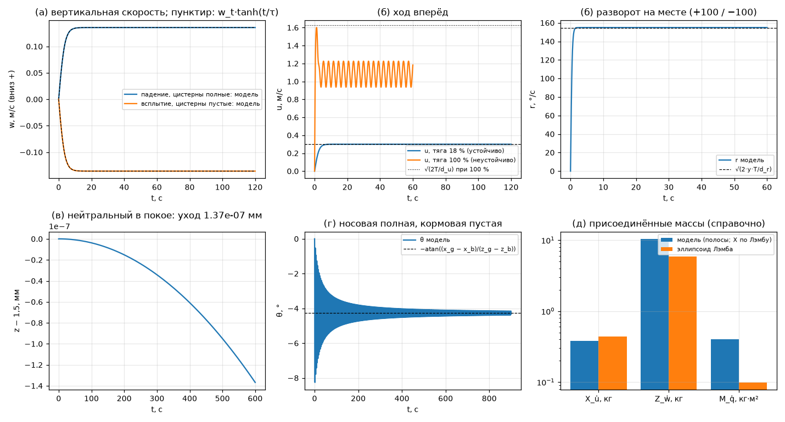

| Сравнение | Формула | Модель | Ошибка | Итог |
|---|---|---|---|---|
| (а) падение, цистерны полные (+70 мл), голый корпус | w_t = √(ΔF/d_w) = 0,1357 м/с, w(t) = w_t·tanh(t/τ) | вся кривая | 0,27 % | пройдено |
| (а) всплытие, цистерны пустые | −0,1357 м/с | вся кривая | 0,27 % | пройдено |
| сброс балласта 1 кг | +8,52 Н, −0,4786 м/с | −0,4786 м/с | 3·10⁻⁵ | пройдено |
| (б) ход вперёд, тяга 18 % | u = 0,300 м/с | 0,2998 м/с | 0,07 % | пройдено |
| (б) разворот на месте ±100 % | r = √(2yT/d_r) = 2,700 рад/с | 2,704 рад/с | 0,15 % | пройдено |
| (в) равновесие 10 мин, 1,5 м | уход < 1 мм | 2,6·10⁻¹⁰ м | | пройдено |
| (г) дифферент: носовая полная, кормовая пустая | θ = −atan((x_g − x_b)/(z_g − z_b)) = −4,268° | −4,266° | 0,04 % | пройдено |
| (ж) полная модель: падение с плоскостями и затуханием | d·w² + c·w = ΔF → 0,05501 м/с | 0,05499 м/с, дифферент 0,07° | 0,03 % | пройдено |
| (д) присоединённые массы против эллипсоида Лэмба | справочно | X 0,87, Z 1,77, M 4,1 раза | | не критерий: у эллипсоида объём 2/3 цилиндра, у модели ещё плоскости и нижняя труба |

(а)-(г) считаются без плоскостей и линейного затухания, чтобы каждая формула проверяла один член уравнения; (ж) проверяет полную модель. В (а) ошибка 0,27 % вместо 10⁻¹³: связь вертикали с дифферентом (несимметричный силуэт, присоединённые массы) даёт в начале падения небольшой поворот, который формула для одной оси не видит; предельная скорость совпадает до 10⁻⁷.

### Находка: корпус неустойчив на ходу

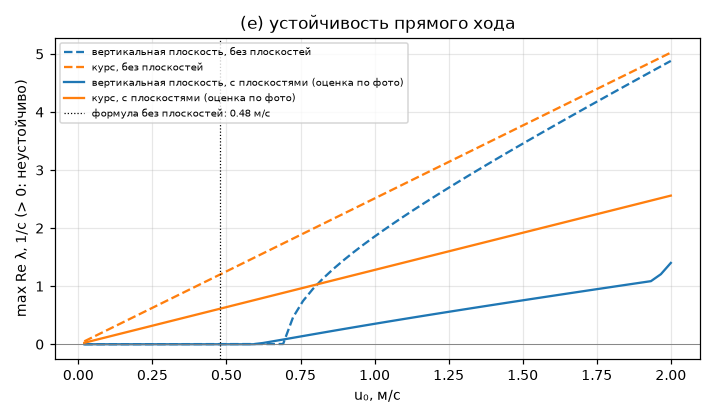

Плоскости и насадки движителей оценены по фото (размеры не измерялись). Собственные числа линеаризованной модели (больше нуля = неустойчиво). Без плоскостей дифферент теперь теряет устойчивость раньше (0,19 м/с): лобовое сопротивление ниже оси и тяга ниже оси дают момент, а момент Мунка считается по полной матрице. Плоскости по фото (с их присоединённой массой) его стабилизируют до 0,62 м/с.

| | Без плоскостей | С плоскостями по фото |
|---|---|---|
| курс: неустойчив с какой скорости | с любой | с любой |
| курс на 0,3 м/с: отклонение растёт в e раз за | 1,4 с | 2,7 с (было 2,3) |
| дифферент: неустойчив с какой скорости | 0,19 м/с (было 0,66) | 0,62 м/с (было 0,49) |

На фото нет вертикальных плоскостей, поэтому по курсу корпус неустойчив; насадки движителей замедляют уход почти вдвое. На реальном аппарате было удержание курса, оператор тоже поправлял. В бассейне ход не измерялся, сравнивать не с чем. Увеличивать плоскости сверх видимого на фото не стал. В игре нужен режим удержания курса (этап 5/7).

## V2. Godot против независимого эталона

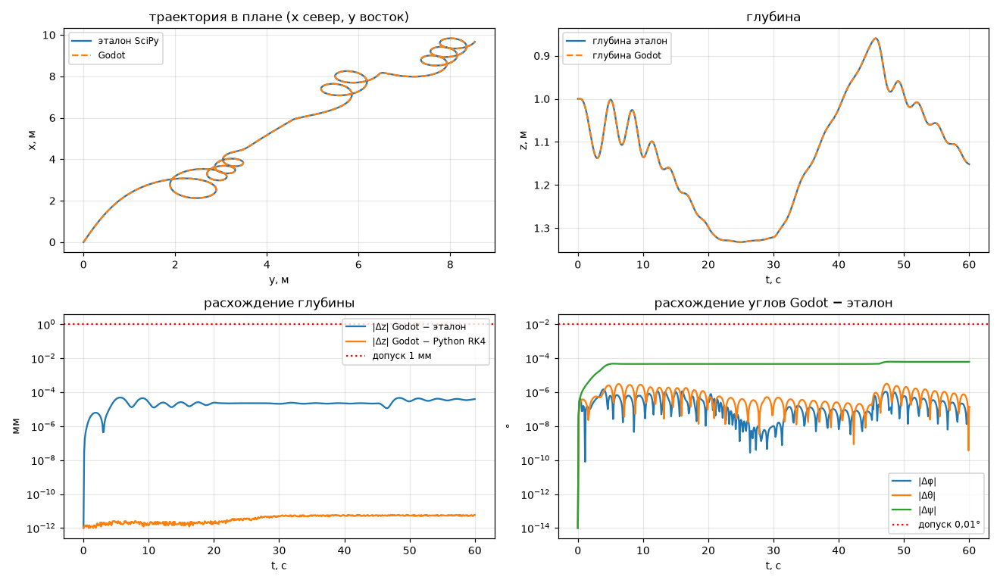

Сценарий 60 с с движителями, цистернами (с упором), течением 0,11 м/с, курсом 17°.

| Пара | Глубина, мм | Положение, мм | Углы, ° | Цистерны, мл |
|---|---|---|---|---|
| Godot против SciPy DOP853 (rtol 10⁻¹¹) | 4,8·10⁻⁵ | 3,5·10⁻³ | 6,2·10⁻⁵ | 0,0012 |
| Godot против Python RK4 (тот же шаг) | 5·10⁻¹² | 6·10⁻¹² | 2·10⁻¹³ | 7·10⁻¹² |

Дополнительно сравниваются производные в трёх состояниях, которых нет в сценарии (крен, дифферент, течение, состояние после сброса груза): наибольшая относительная разница 2·10⁻¹⁶.

Критерий (глубина < 1 мм, углы < 0,01°): **пройдено**. Оговорка: GDScript это порт тех же формул, поэтому V2 проверяет порт и шаг интегрирования, а формулы проверяют V1 и V6. Шаг RK4 в Godot 0,5 мс (200 Гц ≈ 10 % одного ядра).

## V3. Удержание глубины

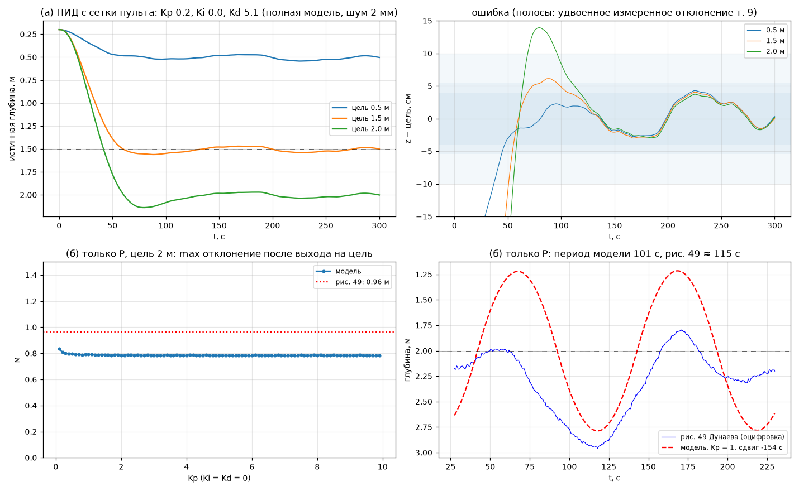

### (б) Только P, цель 2 м: предсказание рис. 49

| | Рис. 49 (оцифровка) | Модель |
|---|---|---|
| max отклонение после выхода на цель | 0,96 м | 0,78-0,84 м при любом Kp 0,1-9,9 |
| период | ≈ 115 с | 101 с |

**Согласуется по двум признакам**: максимальное отклонение на 15-20 % меньше, период на 12 % короче. Рис. 49 в калибровке не участвовал. На графике модель сдвинута по времени до совпадения нижних точек: начальное состояние в опыте не известно.

**Остаётся несовпадение формы**, данными оно не устраняется: модель качается симметрично вокруг цели (1,27-2,78 м, размах 1,5 м), а реальный аппарат ниже цели (1,8-2,95 м, размах 1,15 м, центр ≈ 2,4 м). Вероятные причины: смещение нуля датчика (пульт вычитает среднее первых показаний), несимметричная работа поршней на наполнение и вытеснение, трос, который тянет вниз сильнее на большой глубине. Проверить любую из них без исходных записей нельзя, поэтому подгонять смещение не стал. Причина та же, по которой подгонка сразу по рис. 48 и 49 не сошлась.

### (а) Настроенный ПИД: предсказание т. 9

ПИД подобран в симуляторе на сетке пульта (0,0-9,9 шаг 0,1): ITAE на цели 1,5 м, среднее по трём реализациям шума датчика. Числа т. 9 в подборе не участвуют. Найдено **Kp = 0,2, Ki = 0,0, Kd = 5,1** (после пересмотра по модели тот же набор). Проверка на полной модели 6 ст. св. (`v3_pid.py`, одна реализация шума, seed 3):

| Цель, м | Бассейн, м | Допуск (×2), м | Модель, установившийся режим (последние 100 с), м | Среднее, м | Перелёт на подходе (20 с после первого пересечения цели), м |
|---|---|---|---|---|---|
| 0,5 | 0,05 | 0,10 | **0,043** | 0,519 | 0,023 |
| 1,5 | 0,02 | 0,04 | **0,041** (не прошло на 1 мм) | 1,518 | 0,054 |
| 2,0 | 0,027 | 0,054 | **0,037** | 2,015 | 0,139 |

Одна реализация шума решает вердикт на 1,5 м случайно, поэтому добавлен прогон с 10 реализациями (`v3_seeds.py`, тот же ПИД и критерий) на новой физике и, для сравнения, на физике этапа 2 (код и параметры из коммита 9b8b4a6):

| Цель, м | Допуск, м | Новая физика: медиана (мин-макс), в допуске | Физика этапа 2: медиана (мин-макс), в допуске |
|---|---|---|---|
| 0,5 | 0,10 | 0,040 (0,021-0,047), 10 из 10 | 0,039 (0,022-0,048), 10 из 10 |
| 1,5 | 0,04 | 0,041 (0,022-0,052), **4 из 10** | 0,039 (0,027-0,046), **5 из 10** |
| 2,0 | 0,054 | 0,038 (0,027-0,048), 10 из 10 | 0,040 (0,022-0,048), 10 из 10 |

Вывод честно: **на 0,5 и 2,0 м модель согласуется с т. 9, на 1,5 м она на границе допуска и до пересмотра, и после**. «Пройдено» на этапе 2 зависело от удачной реализации шума. Пересмотр корпуса почти не изменил картину (медиана +1,4 мм): удержание определяют поршни и шум датчика, а не форма корпуса. Критерий не менял. Критерий взят по установившемуся режиму, потому что Дунаев включал запись **после** достижения глубины (4.1, по отметкам на трубе). Перелёт на подходе у модели до 14 см на 2 м; в бассейне подход не записан. Остаётся медленный цикл ±2-3 см с периодом 107-140 с: за 20 с записи его видно как дрейф в пределах нескольких сантиметров.

Чем оплачено совпадение (то есть что тут подогнано): шум датчика глубины. По записям Дунаева он от 2 до 7 мм, а т. 9 достижима только при шуме не больше ≈ 3 мм (при 5 мм лучшее, что даёт сетка, 8 см; при 9 мм 25 см). Взято 2 мм, нижняя граница. Значит, утверждение звучит так: «модель согласуется с т. 9, если датчик глубины шумит на уровне 2-3 мм». Это нужно проверить по паспорту датчика давления.

Чувствительность (те же коэффициенты, цель 1,5 м, установившийся режим):

| Вариант | max откл., м | только P на 2 м: период, с |
|---|---|---|
| базовый (нейтральность 70 мл) | 0,041 | 101 |
| без шума датчика | 0,018 | |
| шум датчика 5 мм | 0,128 | |
| нейтральность 40 мл (перекалибровано: 0,83 мл/с, 4,3 Н·с/м) | 0,040 | 117 |
| нейтральность 100 мл (перекалибровано: 2,14 мл/с, 15 Н·с/м) | 0,034 | 48 |
| прогноз Дунаева T = 12 с | 0,65 | |

Вывод по нейтральности: при 40-70 мл период рис. 49 предсказывается (101-117 с против 115), при 100 мл нет (49 с). Значит, рис. 49 сам по себе указывает, что нейтральность не выше ≈ 70 мл. Прогноз глубины Дунаева (T = 12 с) с этими коэффициентами портит удержание; был ли он в прошивке, не известно.

## V4. Датчики

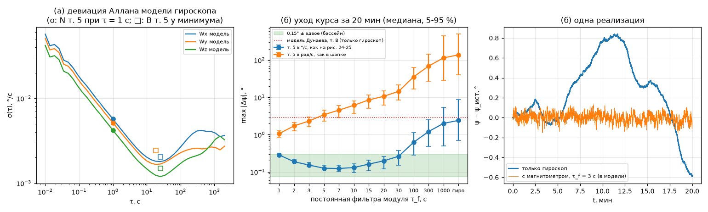

### (а) Генератор шума против таблицы 5

| Ось | N из т. 5, °/√с | Модель при τ = 1 с | Ошибка | B из т. 5, °/с | Минимум модели, °/с |
|---|---|---|---|---|---|
| Wx | 0,0057 | 0,00569 | −0,2 % | 0,00203 | 0,00179 (при 25 с) |
| Wy | 0,0051 | 0,00514 | +0,7 % | 0,00243 | 0,00166 (при 18 с) |
| Wz | 0,0042 | 0,00420 | −0,1 % | 0,00149 | 0,00120 (при 25 с) |

N воспроизводится точно; минимум на 12-32 % ниже табличного B (нестабильность приближена процессом Гаусса-Маркова). Про положение минимума см. «Калибровка по опытам в бассейне», п. 1.

### (б) Уход курса за 20 минут (20 прогонов, медиана)

| τ_f, с | 1 | 2 | 3 | 5 | 7 | 10 | 15 | 20 | 30 | 100 | 1000 | только гироскоп |
|---|---|---|---|---|---|---|---|---|---|---|---|---|
| т. 5 в °/с, ° | 0,29 | 0,19 | **0,15** | 0,13 | 0,12 | 0,13 | 0,16 | 0,20 | 0,26 | 0,62 | 2,0 | 2,41 |
| т. 5 в рад/с, ° | 1,1 | 1,7 | 2,3 | 3,4 | 4,5 | 6,1 | 8,5 | 11 | 15 | 35 | 115 | 138 |

- **Предсказание (без подгонки):** «только гироскоп» 2,41° против 2,85° в моделировании самого Дунаева (т. 8). Согласуется.
- **Подгонка:** с магнитометром в допуск 0,075-0,3° попадает любое τ_f от 1 до 30 с; ровно 0,15° даёт τ_f = 3 с, оно и взято. Устройство фильтра модуля не известно, поэтому это калибровка, не проверка.

## V6. Здравый смысл

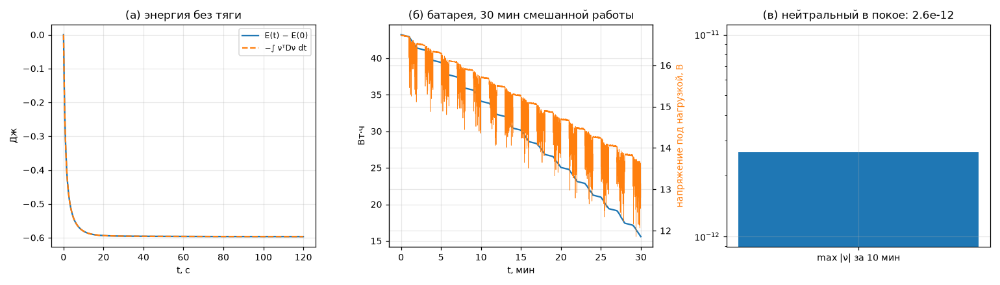

| Проверка | Результат | Итог |
|---|---|---|
| (а) без тяги, с начальными скоростями по всем осям, 120 с: механическая энергия (кинетическая с присоединёнными массами + потенциал) | ни на одном шаге не выросла; убыль 0,60 Дж равна работе сопротивления по силуэтам, плоскостей и линейного затухания с точностью 2·10⁻⁵ Дж | пройдено |
| (б) батарея, 30 мин смешанной работы | энергия только убывает, расход = ∫P dt | пройдено |
| (в) нейтральный аппарат в покое 10 мин | скорость 2,6·10⁻¹², уход глубины 9·10⁻¹³ м | пройдено |

Батарея 43,2 Вт·ч выбрана под «до 2 часов» (данные автора) при средней нагрузке ≈ 21,6 Вт; одна электроника и лампа без хода протянут 3,5 часа. Средняя нагрузка тоже оценка.

## V5. Подводный свет (этап 4)

Модель: `physics_ref/rov/light.py` (эталон) и `godot/shaders/underwater.gdshaderinc` (шейдер), числа `godot/physics/light_params.json`, источники `physics-sources.md`, разд. 17-21. Данные: кадры мишени Холопова (`data/Kholopov-progs`: 2,7 м, СДВС5 50 и 100 %, т. 4; лампа аппарата против СДВС5, т. 12; кадры ΔE 1 / 2 / 2,7 м и мутный 1 м) и статья Игнатьевой и Кузьменко 2024 (рис. 10-13 оцифрованы: `work/tools/digitize_article.py`, рис. 12-13 автоматически, рис. 10-11 вручную в трёх узлах; `docs/verification/article_*.csv`, наложения `article_fig1*_check.png`). Важное из статьи: кривые по базе сняты на **2,0 м**, по дальности при базе 0,5 м; кривые статьи на 2,7 м почти совпадают с т. 4 Холопова (та же установка).

**Шаг 0. Обработка как у Холопова** (`v5_frames.py`): углы из `plate_corners.mat`, выпрямление, серое Rec.601, медианы окон, K = |B − B₉|/255 без `histeq`. Т. 4 повторена с расхождением ≤ 0,0044, т. 12 до 0,002. Значит, сравниваем то же, что считал Холопов.

**Шаг 1. Кадр линеен по альбедо** (Akkaynak & Treibitz 2018): в каждом канале I = S·ρ + V. По 10 секторам (ρ по эталону на воздухе, sRGB → линейное, белый = 0,85) R² = 0,96-0,99 в зелёном, 0,75-0,97 в красном и синем. Отношение V/S (вуаль к сигналу) не зависит от экспозиции, усиления и мощности лампы: его и сравниваем с моделью.

**Шаг 2. Подгонка** по двум кадрам т. 4 (2,7 м, СДВС5, база 0,5 м сбоку, оценка): b_p550 = 0,290 1/м по зелёному, доп. поглощение 0,091 / 0,062 1/м по красному и синему. Без него зелёный сектор не мог бы спадать положе красного: в чистой воде разница поглощения R и G всего 0,13 1/м.

**Шаг 3. Предсказания V/S** (без подгонки):

| Кадр | V/S измерено (R, G, B) | модель | b_p550, при котором модель совпала бы |
|---|---|---|---|
| СДВС5 50 %, 2,7 м, т. 12 (другой день) | 0,38 / 0,19 / 0,30 | 0,25 / 0,13 / 0,20 | 0,34 |
| лампа аппарата 50 % на раме, 2,7 м, т. 12 | 0,42 / 0,22 / 0,30 | то же | 0,36 |
| СДВС5, 2,7 м, кадр ΔE | 0,23 / 0,17 / 0,30 | то же | 0,32 |
| лампа аппарата на аппарате, 1 м, кадр ΔE | 0,011 / 0,011 / 0,053 | 0,053 / 0,044 / 0,057 | 0,10 |
| СДВС5, 2 м, кадр ΔE | 0,25 / 0,28 / 0,28 | 0,066 / 0,045 / 0,063 | 0,65 |
| мутная, 1 м, кадр ΔE | 0,62 / 0,56 / 0,58 | — | 1,04 |

Кадры на 2,7 м разных дней согласуются (b 0,29-0,36). Кадры 1 и 2 м из папки ΔE дают воду в 3 раза чище и в 2 раза мутнее: либо другая вода (другие дни), либо другая геометрия (база кадров ΔE не известна); данных для уточнения нет.

**Шаг 3б. Контраст т. 4** при экспозиции по белому сектору кадра (8 оставшихся секторов предсказаны): средний 0,211 против 0,275 (−23 %) при 50 %, 0,228 против 0,294 (−22 %) при 100 %. Хуже всего зелёный и синий (−35…−39 %).

**Шаг 4. Выводы статьи** (автоэкспозиция: средний уровень кадра постоянен, цель калибруется один раз по белому т. 4):

| Пункт | Статья | Модель | Итог |
|---|---|---|---|
| (а) контраст убывает с дальностью, минимум ≈ 0,15 | спад с 0,8 м (у секторов 2, 6, 8 подъём до 1,0 м); минимум 0,137-0,15 | все секторы на 2,7 м ниже, чем на 0,8 м, но рост до 1,1-1,4 м (до +0,055); минимум 0,102 | **не пройдено** (строгий и уточнённый критерии). Вероятная причина в модели автоэкспозиции (доля планшета в кадре, оценка), не в оптике воды |
| (б) зелёный спадает положе красного, розового, фиолетового | да | K(2,7)/K(0,8): зелёный 0,61, красный 0,53, розовый 0,57, фиолетовый 0,53 | **пройдено** (за счёт подогнанного доп. поглощения в R) |
| (в) 50 → 100 % контраст не растёт | даже чуть падает | с автоэкспозицией ровно 0 (в однократном рассеянии всё ∝ мощности); при постоянной экспозиции рос бы на +0,06…+0,11 | **пройдено** |
| (г) база 0,1 → 0,5 м сильно повышает контраст, дальше рост замедляется | ×3,0, затем ×1,09 (2,0 м) | ×3,0, затем ×1,16 | **пройдено**, без подгонки |
| числа кривых, ±25 % | рис. 12-13 | 71 % (50 %) и 62 % (100 %) значений в ±25 %; спад K(2,7)/K(0,8) 0,45 против 0,45 и 0,40 против 0,42; средние на 1,5 и 2,0 м −3…−11 %, на 0,8 и 2,7 м −24…−28 % | **согласуется** (критерий: не меньше половины значений) |
| ΔE растёт с дальностью (Холопов 9,44 / 27,04 / 31,57) | | 7,7 / 15,7 / 21,2 | **пройдено качественно** (камеры и баланс белого не известны) |

Критерий (а) уточнён после сверки с рис. 12, где подъём на 0,8-1,0 м есть у самой статьи: «K(2,7) < K(0,8) у каждого сектора и монотонный спад от 1,0 м». Модель не проходит и его. Первая формализация (г) по абсолютному приросту тоже записана в `v5_light.json` (проходит).

**Порт в Godot** (`godot/tests/light_render_test.tscn` → `v5_godot.py`): 6 конфигураций (бассейн и мутная вода, 1-2,7 м, базы 0,1-0,5 м, со светом сверху и без), пиксель центра каждого из 10 секторов (среднее блока 8 × 8) против эталона с 2000 шагов интеграла: **≤ 2/255**. Проверка нашла особенность рендера Compatibility: 3D-кадр хранится в 8-битном линейном буфере с отбрасыванием дроби (тёмные тона слипались, расхождение доходило до 7/255). Исправлено дизерингом Байера в шейдере (`physics-sources.md`, разд. 21).

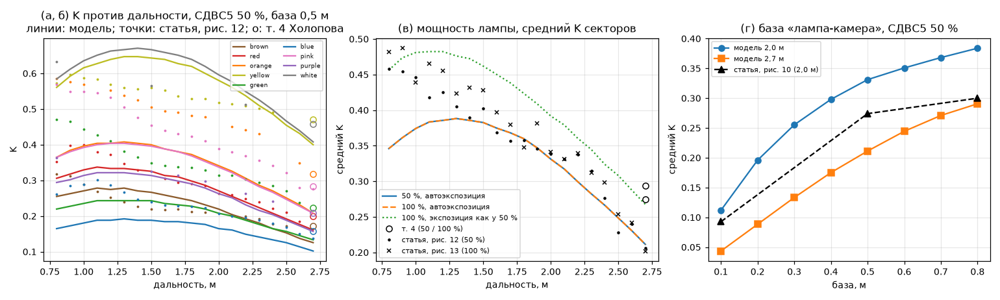

Оцифровка рисунков статьи (наложение найденных точек на исходный рисунок):

| 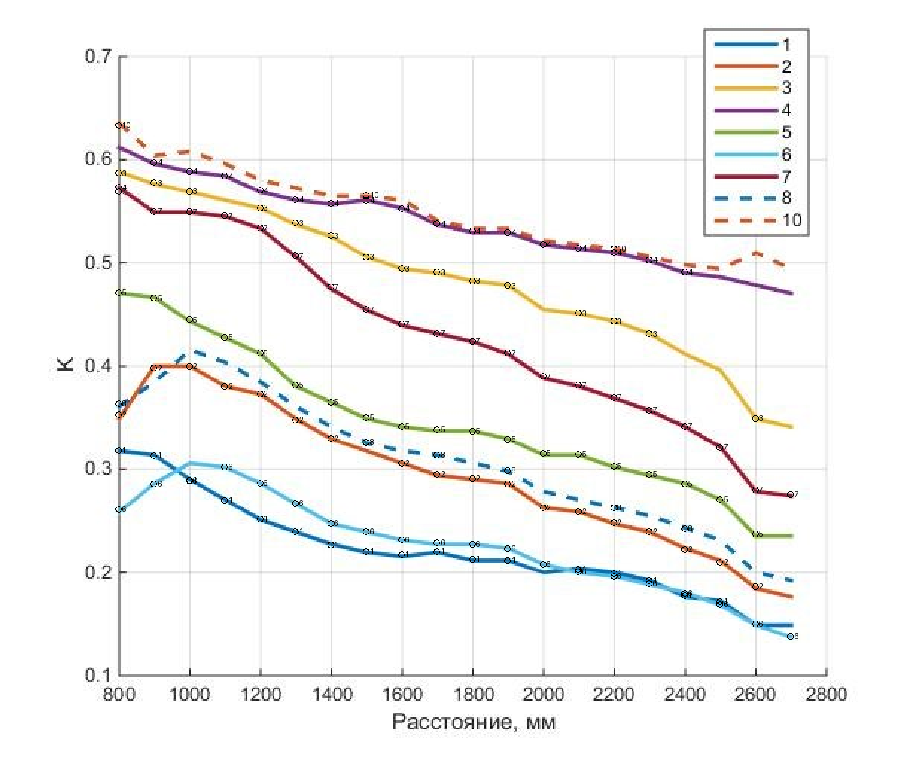 | 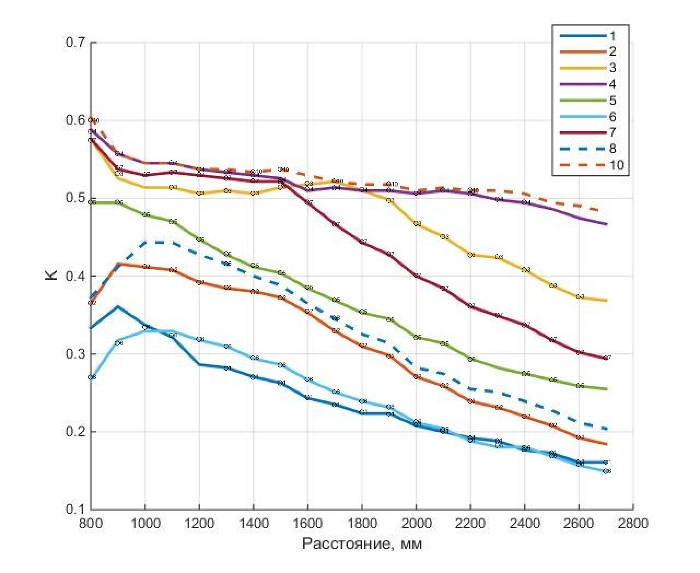 |
|---|---|
| рис. 12: контраст против дальности, 50 % | рис. 13: то же, 100 % |

Полный вывод: `v5_light_output.txt`, числа `v5_light.json`, `v5_frames.json`, `v5_godot.json`.

## Этап 4: уровни

Доработка 2026-11-02: все три сцены пересобраны в Blender со «сухими» рендерами (`docs/levels/*_dry.png`), судно — скан настоящего судна (CC BY), добавлены видимая взвесь, подводные светильники с ореолом, каустика, автоэкспозиция, текстуры с рельефом. Числа ниже — после доработки.

| Проверка | Результат |
|---|---|
| Правила колец (`godot/tests/game_tests.gd`, 12 проверок): проход по оси, обратный проход, облёт, порядок +15, пропуск +30, финиш на 6-м, касания с паузой 0,4 с, таблица лидеров JSON + CSV | **пройдено** |
| Правила осмотра судна (6 проверок): 3 м, 35°, заслонение, 1,5 с подряд, старт после 0,5 м | **пройдено** |
| Кольца проходятся на физике аппарата в новом бассейне (`--auto`, автопилот проверки `tests/ring_autopilot.gd`: глубина ПИД пульта на цистернах, курс и ход стиком) | 6 из 6 по порядку, **286,8 с**, штраф 0, 2 касания кольца 4; результат записан в таблицу лидеров |
| Осмотр судна с отчётом (`--auto`, облёт кинематикой: проверяет правила, заслонение, кадры и отчёт, а не управляемость) | 6 из 6 за 84,7 с, касаний 0 (пример: `docs/levels/wreck_report_example.md`, кадры `docs/levels/wreck_survey_frames.png`) |
| Порт света после доработки (10 шагов, светильники и каустика выключены) | ≤ 2/255, **пройдено** |
| Кадры/с, 1280 × 720, ПК автора (Ryzen 5 5500U, Radeon встроенная), 3 сцены × 2 камеры | с синхронизацией: бассейн 60 в среднем (минимум 48), судно и лабораторный 60 (минимум 34-59); без синхронизации: бассейн 45-49 (минимум 36-38), судно 64-137, лабораторный 50-263 (`fps_stage4.txt`); 5 минут в бассейне (S5): в среднем 60,0, 1 % худших 60, минимум 44,3 (`fps_stage4_5min.txt`) |

Находки доработки:
- Первый прогон колец застрял на кольце 6 (просвет 0,7 м): автопилот шёл на 0,23 м ниже центра. Погрешность тестового автопилота (допуск по глубине); после ужесточения кольцо взято чисто.
- Сфера «бесконечной воды» вокруг аппарата рисовалась первой на весь экран; переведена в прозрачный проход.
- 10 светильников бассейна сначала снизили кадры/с в 6 раз; помогли формула ореола через таблицу (без цикла), массивы вместо float-текстуры, отсечение далёких источников (217 → 49 к/с без синхронизации).
- В камере аппарата у судна — серая пелена обратного рассеяния: лампа в 10 см от объектива в мутной воде. Это физика (статья: база 100 мм худшая), внешняя камера видит чётко. Подгонять «мёртвую зону» перед объективом под кадр 1 м не стал: корпус камеры затеняет только ~3 см, а кадры сняты в разные дни.

---

## Этап 5: интерфейс и стиль

Экран, меню и управление описаны в [`ui.md`](ui.md). Проверки критериев S4, S5, S7:

| Проверка | Результат |
|---|---|
| S4 Управление как у пульта (`godot/tests/game_tests.gd`, 13 проверок): стрелки = правый стик до упора, микширование L = y + x, R = y − x с нормировкой, ось Y геймпада, зона 15000, цистерны только с LT/RT (как кадр пульта), шаги цели 10/50/100/500 мм, у клавиш нет двойных назначений, в управлении нет крена, бокового и вертикального хода; настройки из командной строки | **пройдено** |
| S7 Таблица результатов (3 проверки во временной папке): кольца — JSON 10 лучших + CSV с заголовком; судно — CSV, лучший по времени первым | **пройдено** |
| S7 на игре: заплыв автопилотом с новым интерфейсом, запись в таблицу и показ на финише | 6 из 6 по порядку за **286,8 с**, штраф 0, 2 касания (как на этапе 4: физика не менялась); строка в `leaders_rings.json` и `rings_results.csv`, таблица 10 лучших на финише и в меню |
| S5 Кадры/с с полным интерфейсом (окошко с силами, график, кривая света), 1280 × 720, ПК автора | **пройдено** (`docs/verification/fps_stage5.txt`, 60 с на прогон). С синхронизацией: стильный вид — бассейн 59,8 в среднем (1 % худших 55,4), судно 58,9 (34,3); научный вид — бассейн 55,0 (30,0), судно 56,6 (30,3). Без синхронизации: стильный 120 / 129, научный 103 / 94. Единичные провалы до 17-34 к/с (один кадр). Для сравнения в тот же день бассейн без интерфейса и окошка — 125 к/с: интерфейс с окошком стоит ≈18 %, стиль (3D в 1/3) это возвращает. На этапе 4 тот же замер давал 45-49 к/с: ПК сегодня быстрее (питание, нагрев — не выяснено), поэтому сравнивать числа этапов напрямую нельзя |
| Старые проверки после правок (физика 15, правила и S4/S7 34, модель 32) | **пройдено** |

Находки этапа:
- **Батарея и лампа:** при 50 % лампа берёт 7,2 Вт по Холопову (в версии этапа 4 игра ошибочно передавала батарее 3,6 Вт), 50 % = 7,2 Вт, 100 % = 14,4 Вт (оценка). Физика и эталон не менялись (`physics-sources.md`, разд. 13).
- Окошко «со стороны» у судна было почти чёрным: экспозиция общая с камерой аппарата, а сбоку аппарат лампой не освещён. Окошку дано своё усиление по замеру моделью света (×1-16, подписано на окошке); на расчёт света это не влияет.
- Протечка не моделируется: на экране всегда «ПРОТЕЧКИ НЕТ».


---

## Этап 6: проверка и портфолио

### Повторный прогон всех проверок (2026-11-02)

Все проверки этапов 2-5 прогнаны заново одним скриптом на текущем коде: модульные тесты эталона (17), V1, V2 (Godot 15 + сравнение), V3(а) одна реализация и 10 реализаций, V4, V5 (кадры и статья), V6, правила и управление (34), модель (32). **Числа совпали с записанными выше**; в файлах результатов `docs/verification/` изменилось только время счёта подбора ПИД в `v3.json` (41,8 → 42,7 с). V5(а) по-прежнему **не пройден**, V3(а) на 1,5 м по-прежнему на границе.

### S1: источники у каждой модели

Новый скрипт `physics_ref/verify/s1_sources.py` проверяет, что в каждом нумерованном разделе `physics-sources.md` есть поля «Источник», «Формула», «Проверка», «Статус», а у каждого числа в `rov_params.json` и `light_params.json` — `value`, `source` и статус из списка проекта.

Первый запуск **нашёл пробелы** в 9 разделах этапов 3-4 (16 модель аппарата, 20 свет сверху, 21 камера, 22 касания, 23 вода сцен, 24 взвесь, 25 светильники, 26 каустика, 27 автоэкспозиция): где-то не было источника, где-то проверки. Дописаны честно: у света сверху, светильников, каустики, автоэкспозиции и двух вод из трёх проверка «не проверить» или «только порт» (измерений нет); отдельной численной сверки ореола светильников с прямым интегралом нет. После этого: 28 разделов, 89 чисел, **пройдено** (`s1.json`). Статусы чисел (составной статус — по самому слабому): проверено 19, подогнано 7, оценка 63.

### Версия 1.1: место крушения — риф у судна и граница (2026-11-02)

Сцена судна переделана (`docs/levels.md`, «Судно»): обрастание корпуса (≈5700 организмов 12 видов экземплярами), рыбы и подвижные животные, дно с ямами размыва и гравием, дальние зоны убраны, граница — кабель 22 м и мутная вода у края (`physics-sources.md`, разд. 28). Физика аппарата не менялась. Попутно у всех текстур включены мип-уровни (уменьшенные копии для дальних участков): их не было, и дальнее дно читало полную текстуру 1k на каждый пиксель — это ускорило все три сцены.

| Что | Результат |
|---|---|
| Правила и управление, физика, модель (`game_tests`, `physics_tests`, `model_tests`) | 34, 15, 32 — все пройдены |
| Свет: шейдер = эталон (`light_render_test` → `v5_godot.py`) | худшее 2/255, пройдено |
| S1 источники (`s1_sources.py`) | 29 разделов (добавлен 28 «мутность у края»), пройдено |
| Осмотр судна автопроверкой (`--auto`) | 6 из 6 за 84,9 с (было 84,6: точка у якоря чуть сместилась вместе с рельефом), касаний 0 |
| Кольца автопилотом (`pool_rings --auto`, без окна) | 286,8 с, штраф 0, 2 касания — как в 1.0 |
| Граница | на 18,6 м от судна обеспечения помехи и подсказка «кабель на пределе», на 22 м — «связь потеряна», «Начать заново» / «Главное меню» (снимки) |

Кадры/с (1280×720; 1.0 и 1.1 сняты подряд в одно время, `docs/verification/fps_v1_1.txt`):

| Сцена, режим | 1.0: среднее / 1 % худших | 1.1: среднее / 1 % худших |
|---|---|---|
| судно, без синхронизации | 123,9 / 70,6 | 142,3 / 113,4 |
| судно у корпуса (`--at -4,3,6.5,326`) | 106,8 / 75,1 | 113,8 / 83,6 |
| судно, полный интерфейс | 121,8 / 76,1 | 129,9 / 98,1 |
| судно, синхронизация 60 Гц | 60,0 / 60,0 | 59,9 / 58,7 |
| бассейн, без синхронизации | 115,9 / 79,9 | 123,0 / 76,1 |
| бассейн, полный интерфейс | 110,1 / 82,2 | 126,8 / 102,8 |
| лабораторный бассейн, без синхронизации | 138,1 / 80,0 | 158,1 / 129,7 |

Как найдено (для будущих правок): до мип-уровней новая сцена была на 25-35 % медленнее 1.0. Замеры по частям (ключи `--no-life`, `--no-fauna`, `--scale3d 0.5`, скрытие объектов) показали: стаи рыб на процессоре (GDScript) стоили ~10 к/с — перенесены в шейдер видеокарты; ~6000 организмов в полной детализации — добавлены упрощённые образцы для ячеек дальше 5 м; цепь якоря из ~110 объектов — один объект; главное — дно до ±60 м без мип-уровней (дно отдельно стоило 5,5 мс против 1,9 мс в 1.0). В строку `BENCH` добавлены `draw_calls`, `primitives`.

Не проверено: другой ПК и видеокарта; как рыбы ведут себя за долгий заплыв (дольше 5 мин); при скорости ПК на батарее (днём синхронизация держала 30 к/с в обеих версиях).

### Версия 1.1: исправления по замечаниям (2026-11-02)

| Замечание | Причина | Что сделано | Проверка |
|---|---|---|---|
| Водоросли не двигаются | в пачках экземпляров (MultiMesh) рендер Compatibility подменяет цвет вершин `COLOR` данными экземпляра: вес колыхания (альфа) был 0; `world_vertex_coords` с пачками не работает | цвет и вес колыхания переданы через UV/UV2, смещение — через `MODEL_MATRIX`; добавлен трепет листа | кадры через 2 с различаются (средняя разница пикселей 0,74 против 0,05 до правки) |
| Рыбы у дна «переливаются и моргают» | та же подмена: у рыб в `COLOR` попадали фаза хвоста и место в стае | цвет рыб — через UV/UV2 | кадры подряд: цвет рыбы постоянный |
| Хвост трясётся у аппарата | у стай частота хвоста умножалась на расстояние до аппарата без накопления фазы — фаза прыгала | частота постоянная, у аппарата растёт только размах | кадры |
| Маски гравия у дна, ржавчины у бочек, ила в лабораторном бассейне не работали (с этапа 4) | экспортёр glTF пишет цвет вершин без альфы, если в материале-превью Blender к нему подключён узел | узлы цвета вершин убираются перед экспортом, байтовый цвет переводится во float | в `.glb` цвет RGBA (VEC4) у дна, бочек, стен и дна лаборатории |
| Цепь якоря висит в воде | точка клюза была задана наугад, вне скана | клюз — точка на борту скана (луч), цепь почти отвесно к дну | снимок |
| Чёрные пятна в бассейне | таблица ореола читалась с фильтрацией за краем: у самого светильника ореол отрицательный, линза — чёрный круг (`physics-sources.md`, разд. 25) | чтение по центрам текселей | 30 с заплыва автопилотом: чёрных линз нет; V5 2/255 |
| Осмотр засчитывался вне кадра и в темноте | правила первой версии (3 м, 35° от оси) и камера вида сзади | 2 м, центр кадра, различимость по модели света, 2 с, только камера аппарата; нос и корма — на поверхности скана | `game_tests` (5 проверок осмотра), автоосмотр 6/6 за 78,5 с |
| Фильтр включён сразу | — | по умолчанию выключен (сохранённое «вкл» сбрасывается один раз), есть в настройках | `game_tests` |
| WASD, режимы управления | — | WASD и стрелки; научный / автопилот / автопилот + ускорение. Доработка: в первом варианте автопилот запоминал курс в момент отпускания, а аппарат по инерции проворачивался ещё на ~100° — и пульт тянул его обратно («не даёт повернуть»). Теперь A/D задают скорость поворота (до 35°/с), после отпускания вращение гасится и курс держится там, где аппарат встал | `game_tests`: автопилот возвращает курс после толчка (0,0° против 90° без него); A 3 с — поворот на 92°, встал на 96° и держит; E ведёт цель глубины; ускорение меняет насос и тягу |

Кадры/с после исправлений (тот же вечер, 1280×720, без синхронизации): судно 132 (1 % худших 110), у корпуса 108 (83), бассейн 126 (107), лабораторный бассейн 148 (134); с синхронизацией 60. Все тесты (35 правил и управления + 5 режимов, 15 физики, 32 модели), V5 2/255, S1, кольца 286,8 с — пройдены.

### Сборка .exe и чистая установка

Сборка: Godot 4.7.2, официальные шаблоны экспорта (SHA512 сверен), предустановка `godot/export_presets.cfg` («Windows Desktop», x86_64, данные внутри .exe). Результат: один файл `ROV-Sim.exe` 169 МБ + `README.txt` + `licenses/` (лицензии Godot и его библиотек, `CREDITS.md`, OFL шрифта); архив `ROV-Sim-1.0.0-windows-x64.zip` 99 МБ. Папка `build/` в git не входит. Версия 1.1.0: `ROV-Sim.exe` 191 МБ, архив `ROV-Sim-1.1.0-windows-x64.zip` 120 МБ (SHA-256 `6373502f…8f04`, файл `.sha256` рядом); на пустом профиле (`APPDATA`, `LOCALAPPDATA` — пустые папки): меню «версия 1.1.0», фильтр выключен, научный режим, кольца автопилотом 286,8 с без штрафа, сцена судна без ошибок.

Находка: выпускная сборка Godot не принимает путь сцены в командной строке. Для проверок и записи видео меню получило аргумент `--level pool / wreck / lab` (сразу в сцену; остальные аргументы читает уровень).

Проверка «чистой установки» (на ПК автора, другого ПК нет):

| Что | Как | Результат |
|---|---|---|
| Новая папка | .exe скопирован в папку с кириллицей и пробелами (`…\чистая установка\ROV-Sim\`), второй раз — распакован из архива | запускается |
| Пустой профиль | `APPDATA` и `LOCALAPPDATA` указывают на пустые папки: нет настроек, таблиц, кэша шейдеров | меню открывается, таблица «пока нет результатов», настройки по умолчанию; `settings.cfg`, таблицы и журналы создаются в новом профиле |
| Нет Godot и Python | `PATH` только `C:\Windows\System32;C:\Windows` | запускается: сборке ничего, кроме Windows и драйвера OpenGL 3.3, не нужно |
| Три сцены | `--level wreck` / `lab` / `pool` со снимком | все открываются, картинка как в редакторе |
| Физика в сборке | `--headless --fixed-fps 60 -- --level pool --auto` | 6 колец за **286,8 с**, штраф 0, 2 касания — то же, что в редакторе; строка в `rings_results.csv` и `leaders_rings.json` |
| Кадры/с | `-- --level pool --bench 30` | в среднем 60,0, 1 % худших 60, минимум 45 |
| Журнал | `%APPDATA%\Godot\app_userdata\ROV-Sim\logs\` | ошибок нет, кроме одной строки движка `custom_samplers` при компиляции шейдера — **только в режиме без окна** (`--headless`, заглушка рендера; в редакторе так же); в оконных запусках её нет |

Чего эта проверка **не покрывает**: другой видеокарты и драйвера (особенно NVIDIA и старые Intel), Windows 11, машины без прав на `%APPDATA%`. Файл не подписан: Windows SmartScreen может предупредить о неизвестном издателе (написано в `README.txt`).

### Портфолио

- `README.md` в корне: объяснение за 2 минуты, схема «как это работает», таблица проверок, управление, сборка.
- 8 снимков `docs/screenshots/` (сняты из игры `--shot`, кроме 08 — рендер модели из Blender).
- `docs/CREDITS.md`: работы, источники физики и света, модели, текстуры, шрифт, программы. Лицензия проекта: код MIT (`LICENSE`), документы и модели CC BY 4.0 (`LICENSE-docs.md`).

---

### Версия 1.2: течение, ил от движителей, кабель-трос (2026-11-03)

Течение у судна (0,1 м/с, профиль у дна, `physics-sources.md`, разд. 9), ил, поднятый струями движителей (разд. 29), кабель-трос с физикой (разд. 30). Уравнения аппарата получили внешнюю силу кабеля; без неё результат V2 (`v2_godot.csv`) совпал с прежним побайтно.

| Что | Результат |
|---|---|
| V7 ил (`verify/v7_silt.py`, `v7_silt.png`) | (а) скорость у дна = 0,30·U0·D/h (Blaauw, van de Kaa) с отличием 1,5 %; (в) баланс масс 4·10⁻¹⁵; (г) оседание точно w_s; (д) интеграл через erf = квадратуре 1,5·10⁻⁹; (ж) Godot = эталон ~10⁻⁸ — пройдено |
| V8 кабель (`verify/v8_tether.py`, `v8_tether.png`) | (а) цепная линия: форма 3,5 мм, натяжение 0,15246 / 0,15244 Н; (б) кабель в течении против уравнений нити: 3,8 мм, натяжение 1,2957 / 1,2949 Н; (в) длина 4·10⁻⁶; (г) подача до 22 м; (д) Godot = эталон 10⁻¹³ м за 2 с — пройдено. (е) чувствительность: сдвиг узла на 10⁻⁹ м через 3-4 с даёт сантиметры (трение и включение звеньев разрывны); (ж) трение по формуле Эйлера: 2,77 против 3,51 — μ_эфф ≈ 0,32 при 0,4 (записано, не подгонялось) |
| V2 с внешней силой | производная Godot = Python до 2·10⁻¹⁶ |
| Профиль течения | среднее по глубине 1,00 (< 0,5 %), Godot = Python |
| Свет: шейдер = эталон (3 новых случая с илом, в том числе два клуба) | худшее 2/255 на всех 9 случаях — пройдено |
| S1 | 30 разделов моделей, 121 число без пропусков полей (проверено 20, подогнано 9, оценка 92) — пройдено |
| Остальное (полный прогон после правок) | V1, V2, V3(б), V4, V5, V6 пройдены; V3(а) — как раньше (1,5 м на границе); тесты Godot (физика, модель, игра) и Python — все пройдены |
| Кольца автопилотом | 286,8 с, штраф 0 — как раньше |
| Осмотр судна `--auto` | 6 из 6; 1.1.0 в тот же день — 78,5 с (84,9 в отчёте 1.1 — число до последних правок правил) |

Ил переделан: дымка без рельефа сквозь муть и без вспышек у лампы, видимые хлопья — частицы-метки массы ила (`physics-sources.md`, разд. 29, «Хлопья»). Сверка с кадром `turbid_1m` подсчётом пятен (ярче фона на 12/255): на кадре ≈ 830 на 1/м мутности, в игре (лабораторный бассейн, 6 с разворота, b ≈ 1,7 1/м у камеры, объектив DiCam 300) 1287 пятен ≈ 770 на 1/м; пятна в игре мельче (медиана 2 против 7 px) — ореол и сжатие настоящей камеры не моделируются (`docs/levels/silt_flocs_lab.png`, `silt_flocs_wreck.png`). Шейдер = эталон после правки дымки: ≤ 2/255. Ил (замеров нет; M по верхней границе литературы — по данным автора о почти нулевой видимости в бассейне кафедры): полный ход поднимает ил, если ось движителя ниже ≈ 0,41 м над дном; в 0,15 м за 10 с полного хода ≈ 50 г; у судна облако уносит струёй и течением. Лабораторный бассейн: 6 с разворота у дна — у камеры b ≈ 0,7 1/м (с водой ≈ 1 1/м, как на кадре `turbid_1m`), 20 с у самого дна — ≈ 200 г, b ≈ 8 1/м, видимость ≈ 0,4 м (`docs/levels/silt_strong.png`). Первая версия (M = 2·10⁻⁴, клуб у дна толщиной 5 см) давала облако, не доходившее до камеры; исправлено: сорванный ил занимает толщину струи, турбулентность над пятном считается и от струй, в бассейне ил не уходит сквозь стены.

Кабель в игре (`--path` — автопилот проверок по точкам, физика настоящая, ход до ≈ 0,5 м/с: быстрее корпус неустойчив по дифференту и без кабеля, V1): аппарат в 1 м над дном обходит судно. Без кабеля проходит все 10 точек (глубина 6,2-7,0 м, дифферент −3…+9°). С кабелем до зацепа идёт так же; у якоря с цепью кабель цепляется, аппарат стоит 78 с при работающих движителях, натяжение до 14 Н, только тогда нос задирается до 15° (`docs/levels/tether_snag.png`). На месте без натяжения дифферент 0,3-0,8°, сила кабеля 0,07 Н. По данным автора, кабель влиял на аппарат только при натяжении или запутывании; с первой оценкой (тонущий пучок, 0,14 Н/м) он задирал нос на ~10°, и на ходу аппарат сам всплывал, поэтому вытеснение кабеля подогнано до 0,02 Н/м (почти нейтральный). Исправления подачи по ходу: помощник, выбиравший кабель по расстоянию, давал всплески до 110 Н у судна и вытаскивал аппарат к поверхности — теперь выбирается только слабина. Блок кабеля поставлен не над корпусом, а в 6 м к югу: иначе начальная форма кабеля проходила сквозь корпус (лучи касаний изнутри сетки не видят).

Кадры/с (1280×720, 1.1.0 и 1.2 подряд в одних условиях, ноутбук на зарядке; `docs/verification/fps_v1_2.txt`, там же сеанс от батареи — вдвое медленнее):

| Сцена, режим | 1.1.0: среднее / 1 % худших | 1.2: среднее / 1 % худших |
|---|---|---|
| судно, старт, без синхронизации | 147,2 / 112,2 | 135,7 / 115,3 |
| судно, у дна в облаке ила | 124,2 / 89,0 | 86,0 / 61,3 |
| судно, старт и у дна, синхронизация 60 Гц | 60,0 / 60,0 | 60,0 / 60,0 |
| бассейн с кольцами | 137,5 / 62,0 | 137,1 / 63,1 |
| лабораторный бассейн | 159,2 / 102,9 | 159,0 / 107,1 |

После хлопьев (тот же сеанс на зарядке, пул 60 000 частиц, без ила выключен): у старта 131,9 / 107,5 (без хлопьев 135,7 / 115,3), у дна в облаке 75,5 / 58,2 (без хлопьев 85,5 / 64,0; 1.1.0 — 126,1 / 96,0), у дна с синхронизацией 60 / 60, лабораторный бассейн 156,3 / 93,8 (1.1.0 — 160,6 / 102,7). Пул 120 000 частиц стоил ещё 20-30 % и без ила — уменьшен.

Камера аппарата по табл. 7 Холопова (140° на воздухе, плоское окно, `physics-sources.md`, разд. 21): проход объектива стоит 6-9 % (бассейн 146,2 / 120,0 против 155,7 / 130,5 у 1.1.0; судно у старта 128,9 / 107,8 против 146,7 / 120,0). Осмотр судна `--auto` с проверкой «в кадре» по проекции объектива: 6 из 6 за 78,5 с, как раньше.

Цель (≥ 30 к/с по 1 % худших) выполнена везде. У дна в облаке ила без синхронизации среднее на 31 % ниже 1.1.0 (облако считается в шейдере для каждого пикселя всех слоёв); с синхронизацией 60 к/с держатся. Кабель стоит ≈ 8 % у старта. Облегчено по ходу: 8 клубов вместо 16, освещённость облака одна на луч, клубы — глобальные параметры шейдера (массивы в сотнях материалов давали рывки), звено кабеля 0,5 м вместо 0,3 (V8 пройдена), кабель рисуется MultiMesh по звеньям и только ближе 12 м к камере. От батареи (сеанс 1) у дна с синхронизацией 26,2 / 19,9 против 30 / 30 у 1.1.0. Не проверено: другой ПК.

## Версия 1.3 (в работе): авторы, меню, звук, фото-режим

Физика, свет и модели не менялись (в `.glb` дописано только поле `asset.copyright`).

- Правила и управление: `tests/game_tests.gd` — 43 проверки, все пройдены (новые: обе копии текста авторов целы по SHA-256, все имена и кафедра на месте). Модели: `tests/model_tests.gd` пройдены после записи `asset.copyright`.
- Сцены (меню, бассейн, судно, лаб. бассейн) открываются без ошибок в журнале. Кольца автопилотом: 286,8 с, штраф 0 (как в 1.2.0).
- Меню (проба клавишами): ← → листают сцены, ↓ уводит фокус в нижнюю строку, Enter открывает страницу, Esc закрывает; Enter во время заставки игнорируется (до исправления он нажимал «Начать» под заставкой — найдено пробой).
- Звук: запись шины Master 8 с — меню −29,9 дБFS, бассейн −26,0, судно на полном ходу −21,6; перегруза нет. На слух не проверено.
- Свойства `ROV-Sim.exe` (пробная сборка): компания, авторские права и описание записываются (Godot 4.7 без rcedit).
- Кадры/с (на зарядке, тот же день, 1.2.0 из git worktree, `--bench 30 --vsync 0 --pip 1 --forces 1 --graph 1 --light_curve 1`): бассейн 146,2 → 146,7 (худший 1 %: 121,4 → 120,0); судно 137,4 → 125,9 в первой паре и 123,7 → 123,3 во второй (худший 1 %: 96,0 → 97,5) — разница первой пары в пределах разброса; лаб. бассейн 143,3 → 142,3 (78,0 → 80,0). С синхронизацией: судно 60/60, бассейн 59,8 (худший 1 % 58). Файл `docs/verification/fps_v1_3.txt`.
- Главное меню C6b и экран погружения D2 (позже в тот же день): `game_tests` 43 из 43; проба клавишами — при запуске фокуса нет, ↓ выделяет «Погружение», Enter открывает выбор, ← → меняют аппарат (на свободном месте «Начать» недоступна), Esc назад, страница настроек открывается и закрывается; сцены без ошибок; кадры/с после правки (сцены не менялись, только тема паузы): бассейн 141,0 (худший 1 % 110), судно 118,0 (72) — против 146,7 и 123,3 утром, в пределах разброса.
- Портативность (сборка `.exe` в папке с кириллицей, `APPDATA` и `LOCALAPPDATA` — пустые папки): судно с F12 и F9, меню, кольца автопилотом (286,8 с, штраф 0); всё записано в `userdata` рядом с игрой; после выхода `%APPDATA%` пуст, в `%LOCALAPPDATA%` — только кэш драйвера AMD. Время до снимка меню без кэша шейдеров Godot: 2,7–2,8 с против 3,0–3,1 с у 1.2.0 (по 3 запуска).
- Сборка 1.3.0: `ROV-Sim.exe` 197 МБ, архив `ROV-Sim-1.3.0-windows-x64.zip` 126 МБ (SHA-256 `15210b6b…88cf`, файл `.sha256` рядом); `licenses/` — лицензии Godot, CREDITS, LICENSE, OFL шрифтов, лицензия звуков Kenney. Архив распакован в папку с кириллицей, `APPDATA` и `LOCALAPPDATA` — пустые папки: свойства exe 1.3.0.0 с авторами, меню «1.3.0», кольца автопилотом 286,8 с без штрафа, у судна снимок F12 и телеметрия F9 в `userdata`; после выхода `%APPDATA%` пуст, в `%LOCALAPPDATA%` — только кэш драйвера AMD.
- Замечено: на ПК автора (Radeon встроенная, OpenGL) Godot иногда падает при выходе (код 139) — так же и у 1.1.0, то есть не новинка 1.2. Зависание всего ПК на другом компьютере (RTX 5070) воспроизвести нечем; зависание по Tab на ПК автора в пробах (редактор и `.exe`, 3 сцены, ил у дна, частые нажатия) не повторилось.

## Как повторить

```
cd physics_ref
.venv/Scripts/python -m unittest discover -s tests -t .
.venv/Scripts/python verify/model_properties.py --write   # после пересборки модели: blender/render_views.py
.venv/Scripts/python verify/calibrate_fig48.py
.venv/Scripts/python verify/v1_analytic.py
D:/Apps/Godot/Godot_v4.7.2-stable_win64_console.exe --headless --path ../godot --script res://tests/physics_tests.gd -- ../docs/verification/v2_godot.csv
.venv/Scripts/python verify/v2_compare.py
.venv/Scripts/python verify/v3_pid.py
.venv/Scripts/python verify/v3_seeds.py
.venv/Scripts/python verify/v4_sensors.py
.venv/Scripts/python verify/v6_sanity.py
.venv/Scripts/python verify/v7_silt.py        # после physics_tests.gd (он пишет v2_godot_silt.csv)
.venv/Scripts/python verify/v8_tether.py      # после physics_tests.gd (он пишет v2_godot_tether.csv)
```
Этап 4 (свет и уровни):
```
.venv/Scripts/python verify/v5_frames.py
.venv/Scripts/python verify/light_coeffs.py --write
.venv/Scripts/python verify/v5_light.py --write
D:/Apps/Godot/Godot_v4.7.2-stable_win64_console.exe --path ../godot res://tests/light_render_test.tscn -- --out ../docs/verification/v5_godot_render.json
.venv/Scripts/python verify/v5_godot.py
D:/Apps/Godot/Godot_v4.7.2-stable_win64_console.exe --headless --path ../godot --script res://tests/game_tests.gd
D:/Apps/Godot/Godot_v4.7.2-stable_win64_console.exe --headless --fixed-fps 60 --path ../godot res://scenes/pool_rings.tscn -- --auto
D:/Apps/Godot/Godot_v4.7.2-stable_win64_console.exe --path ../godot res://scenes/wreck.tscn -- --auto
D:/Apps/Godot/Godot_v4.7.2-stable_win64_console.exe --path ../godot res://scenes/pool_rings.tscn -- --bench 60
```
Этап 6 (S1, сборка, чистая установка; шаблоны экспорта Godot 4.7.2 в `%APPDATA%\Godot\export_templates\4.7.2.stable`):
```
.venv/Scripts/python verify/s1_sources.py
D:/Apps/Godot/Godot_v4.7.2-stable_win64_console.exe --headless --path ../godot --export-release "Windows Desktop" ../build/ROV-Sim/ROV-Sim.exe
D:/Apps/Godot/Godot_v4.7.2-stable_win64_console.exe --headless --path ../godot --script <полный путь>/work/tools/export_licenses.gd -- <полный путь>/build/ROV-Sim/licenses
ROV-Sim.exe --headless --fixed-fps 60 -- --level pool --auto        # из папки сборки, APPDATA на пустую папку
ROV-Sim.exe -- --level pool --bench 30
```
Рядом с .exe кладутся `work/tools/build_README.txt` (как `README.txt`), `docs/CREDITS.md`, `LICENSE`, `godot/assets/fonts/*-OFL.txt` (PT Mono, PT Sans, Unbounded, IBM Plex Sans, IBM Plex Mono) и `godot/assets/audio/kenney_interface_sounds_license.txt` (в `licenses/`).

Сцены (Blender без окна, из корня проекта; скан судна должен лежать в data/models/malpas_metal_boat_wreck):
```
python work/tools/get_polyhaven.py 1k brown_mud_02 brown_mud_03 brown_mud_rocks_01 dense_sand rock_boulder_dry rust_coarse_01 green_metal_rust concrete_wall_006 rubber_tiles anti_skid_tiles
python work/tools/make_pool_tiles.py
D:/Apps/Blender/blender.exe -b --factory-startup --python blender/build_pool.py -- --render <папка>
D:/Apps/Blender/blender.exe -b --factory-startup --python blender/build_wreck_scan.py -- --render <папка>
D:/Apps/Blender/blender.exe -b --factory-startup --python blender/build_wreck_site.py -- --render <папка>
D:/Apps/Blender/blender.exe -b --factory-startup --python blender/build_lab_pool.py -- --render <папка>
```
Рисунки статьи: `python work/tools/pdf_images.py "data/Статья Игнатьева Кузьменко.pdf" <папка>`, затем `work/tools/digitize_article.py <папка> <вывод>`.
Рисунки из PDF: `python work/tools/pdf_images.py <pdf> <папка>` (только чтение PDF), оцифровка: `work/tools/digitize.py` (привязка осей записана в нём).

## Что осталось открытым

1. **Датчик давления**: модель и паспорт. Совпадение V3(а) держится на шуме 2-3 мм.
2. Точка нейтральности (70 мл по коду Дунаева; рис. 49 указывает, что не выше ≈ 70 мл) и замеры поршня (расход).
3. Замеры плоскостей и насадок (курс неустойчив, V1).
4. **Масса** (взвесить: модель даёт 8,2 кг вместо «около 10») и центр масс (подвес на нити).
5. Модель движителя и тяга.
6. Рис. 51, 53, 55, 56 в PDF векторные, извлечь не удалось. Если найдутся картинками или исходными данными, V3(а) и V4 можно будет сравнить по форме, а не по одному числу.
7. Свет: цвет стен и дна бассейна кафедры, расстановка камеры и СДВС5, автоэкспозиция ПВК2HD, база кадров ΔE; почему вода в кадрах 1 и 2 м отличается от кадров 2,7 м (`physics-sources.md`, вопросы 7-9).
8. V5(а): рост контраста до 1,1-1,4 м в модели против спада с 0,8 м в статье. Вероятная причина: модель автоэкспозиции (средний уровень кадра с долей планшета). Можно уточнить, если известно, как работала автоматика камеры.
